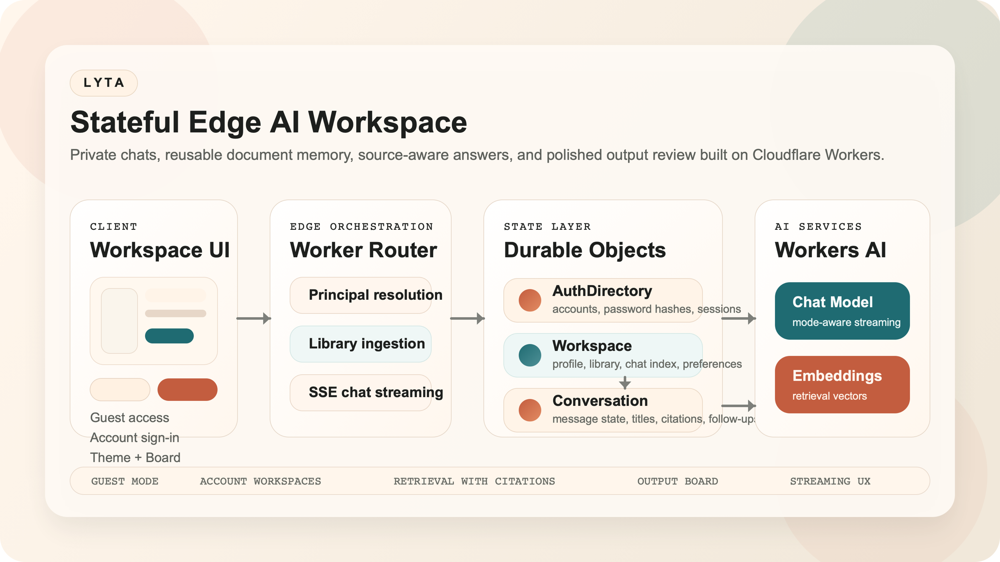
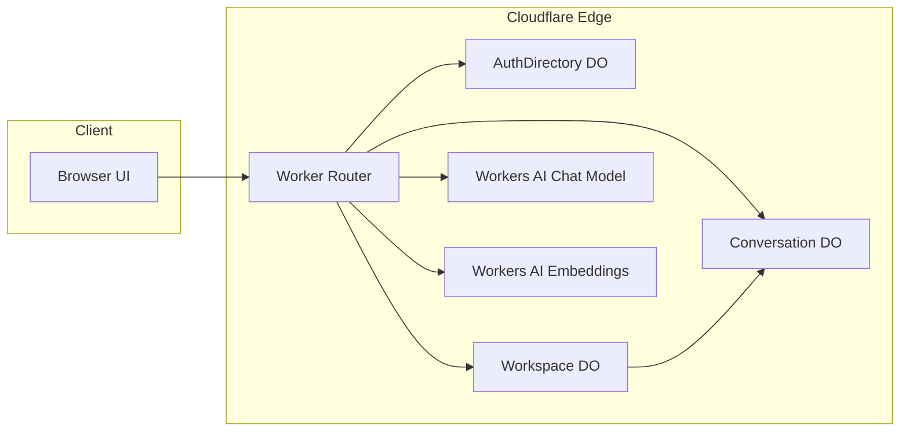
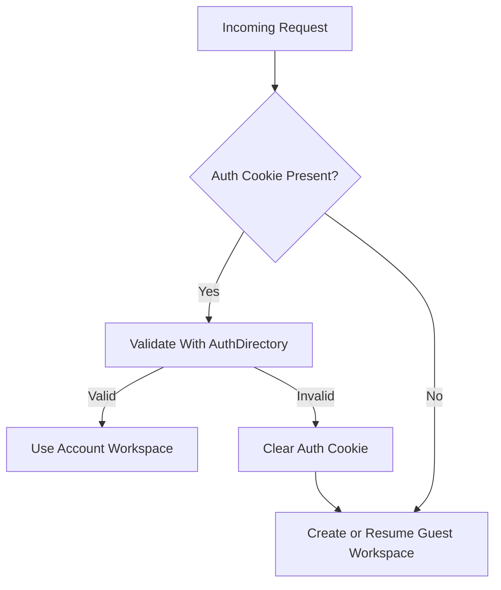
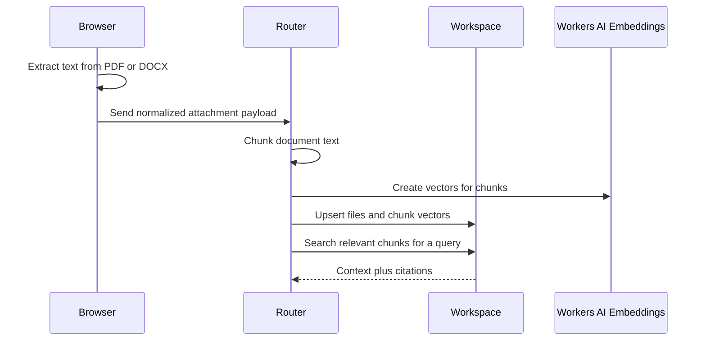
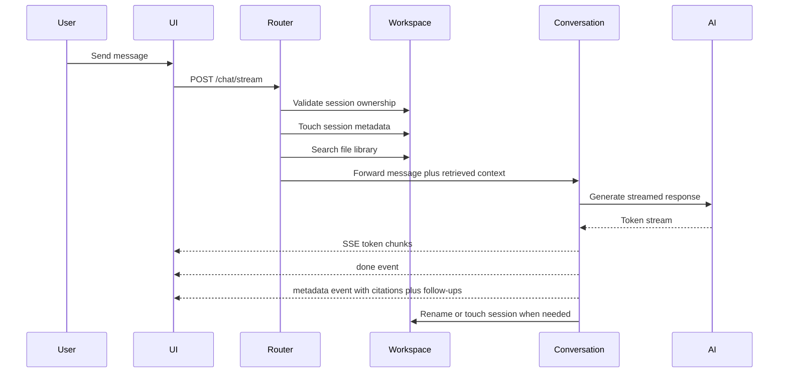
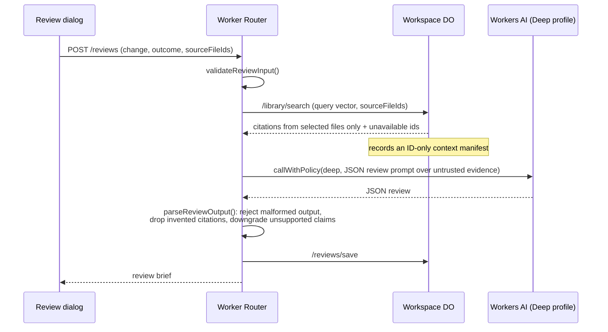

# LYTA Architecture

This document explains how LYTA is structured and why the main design choices were made.

## Visual Architecture

  

## Design Goals

LYTA was built around a few explicit goals:

- make chat state isolation real, not implied
- support both guest usage and account-backed persistence
- treat uploaded files as reusable knowledge, not one-shot attachments
- keep the architecture small enough to understand end-to-end
- make the project presentable as a serious engineering portfolio repo

## High-Level System

## Durable Object Responsibilities

### `AuthDirectory`

Purpose:

- store account records
- create and validate auth sessions
- isolate password and session logic from the rest of the app

Why:

- account state has different lifecycle and sensitivity than chat state
- centralizing auth avoids duplicating session logic across workspaces

### `Workspace`

Purpose:

- store one workspace's profile and preferences
- maintain the workspace chat list
- store reusable uploaded files
- store searchable document chunks and vectors
- store architecture change reviews and their finding dispositions

Why:

- workspace-level state is a separate concern from conversation memory
- this is the right boundary for guest mode and account mode alike
- file memory naturally belongs to the workspace, not a single chat

### `Conversation`

Purpose:

- manage one chat's recent messages
- generate short titles
- summarize older context
- persist streamed replies, citations, and follow-ups

Why:

- one chat per Durable Object creates clean state isolation
- ordered execution matters for streaming and persistence correctness

## Principal Resolution Model

LYTA supports two workspace entry modes.

### Guest Mode

- no login required
- backed by a temporary guest cookie
- still uses a real server-side workspace
- good for trial, demo, or low-friction access

### Account Mode

- authenticated through `AuthDirectory`
- mapped to a private user workspace
- retains chats, library files, theme, and profile settings

This model gives low-friction onboarding without sacrificing clean user isolation.

## File and Retrieval Pipeline

### Why Parsing Starts In The Browser

Benefits:

- keeps the Worker runtime simpler
- avoids adding a separate ingestion service
- reduces server-side file parsing complexity

Tradeoff:

- OCR is not included yet, so scanned PDFs still need a future pipeline

### Why Retrieval Lives At The Router Layer

The router is the correct orchestrator because it can:

- resolve the current principal
- access the correct workspace
- import new attachments into the workspace library
- run library search before the conversation request
- forward enriched context to the chat Durable Object

That keeps the `Conversation` Durable Object focused on conversation behavior, not cross-service coordination.

## Chat Request Lifecycle

## Frontend Structure

The frontend is intentionally framework-free.

Main responsibilities in `pages/app.js`:

- bootstrap the current workspace
- maintain current session state
- manage uploads and attachment previews
- stream assistant responses
- render citations and follow-up prompts
- manage guest versus account mode UI
- manage profile, theme, and library drawers
- manage the output board

Why this is useful for the project:

- easier to understand in a portfolio setting
- fewer moving parts for a small but serious product
- keeps the architecture emphasis on system design rather than framework ceremony

The review workspace lives in `pages/app-review.js`, with its typed, DOM-free
helpers compiled from `pages-src/app-review-core.ts`. It is kept out of
`app.js` so the review workflow can grow without touching the chat client.

The workspace is organised around review output rather than chat (#8):

- **Review is the default view.** `body.view-review` shows the review centre
  panel (start form, brief, or project records) and the **Source evidence**
  panel. `body.view-chat` shows chat and the output board. The topbar
  Review/Chat switch toggles between them, and elements are marked
  `.review-only` or `.chat-only`.
- **Selecting a claim drives the evidence panel.** It shows the claim, its
  evidence state, and each cited passage with file identity and retrieval
  context. That context comes from `retrievedFor`, `rank` and `retrievalSize`,
  which the review contract records on every evidence item. The challenge and
  decision actions sit next to the evidence they act on.
- **Records are first-class.** The sidebar lists reviews and record counts by
  kind. The records view creates records directly through
  `POST /context/records` and reopens a record's source review.
- **The two scripts coordinate through DOM events, not shared state.**
  `app.js` emits `lyta:workspace-ready` after bootstrap, so the review script
  never races the first request into a second guest workspace, and emits
  `lyta:library-changed` when files change. `LytaCore.announce()` drives the
  shared live regions.
- **Below 980px, side panels become bottom sheets** with focus management.
  Between 981 and 1180px, panels narrow instead of floating over the centre.

See [`docs/design/design-system.md`](docs/design/design-system.md) for tokens,
components, states, and accessibility rules.

## Architecture Change Review

Reviews are the flagship workflow: a proposed change is checked against
selected workspace sources and the result is a structured brief, not a chat
reply.

Design decisions:

- **Retrieval stays at the router, scoped in the Workspace DO.** The router
  reuses `searchWorkspaceLibrary()`; the Workspace DO filters chunks to the
  selected file ids and reports ids that are not in this workspace's library,
  so a deleted or cross-workspace source is refused instead of silently
  reviewed without it.
- **The model never gets to define what counts as evidence.** Evidence is
  addressed by short refs (`E1`, `E2`, ...) that map to canonical chunk ids.
  Validation keeps only citations from that set, so `evidence-backed` always
  means "a retrieved chunk the user can inspect supports this."
- **Validation corrects grounding but rejects structure.** A malformed reply is
  an error and is never stored. A well-formed reply with weak grounding is kept,
  with every server-side correction listed in `adjustments` and shown in the
  brief, so reviewers can see what the server changed and why.
- **Dispositions reuse canonical context.** Accepting a finding writes a
  `finding` context record with chunk-level provenance, so the existing
  source-deletion path invalidates it like any other derived record. Deleting
  a source also clears its excerpts from stored reviews.

### Challenging a conclusion

`POST /reviews/:id/findings/:findingId/challenge` re-runs retrieval over the
review's own sources with a query built from the finding and the reviewer's
doubt, then asks the `deep` profile for a verdict on that one finding.

- **Same contract, same rules.** `parseChallengeOutput()` rejects malformed
  replies and keeps only citations from the retrieved set. A `revised` or
  `withdrawn` verdict without retrieved counter-evidence becomes
  `insufficient evidence`. When retrieval returns nothing, the model is not
  called at all. This matters once library search enforces a similarity floor.
- **History, not overwrite.** `applyChallenge()` appends a challenge record
  with the finding's before/after snapshot. New passages the challenge relied
  on are appended to the review's evidence under the next free `E` ref, so
  citations in older challenges stay valid.
- **Consequences are explicit.** A changed conclusion clears the old
  disposition and deletes its context record, since that decision applied to
  the previous claim, and re-runs the readiness guards. Each consequence is
  recorded in `adjustments`.
- **No lost updates.** The router computes the challenge against a snapshot of
  the review. The Workspace DO stores it only if the review's `updatedAt`
  still matches, and otherwise returns `409` so the caller retries.

### Findings as project records

Accepting a finding with `recordAs` saves it as a `finding`, `decision`,
`risk`, `assumption`, or `follow-up` context record with chunk-level
provenance and an `origin` link to its review. These kinds share the existing
context-record storage and source-deletion invalidation. The UI lists them
under **Project records**, independent of any chat.

Not yet implemented: review types beyond architecture changes, and owner/date
fields on the review input.

## Output Board Philosophy

The board is not a side gimmick. It exists because chat alone is often a poor final surface for useful work.

The board gives LYTA:

- a clearer artifact-reading surface
- fast copy and export behavior
- a more product-like feeling than a pure message list

This is one of the more distinctive parts of the project because it moves the app away from "just another chatbot clone."

## Security and Isolation Notes

- account sessions are stored as hashed tokens
- password hashing uses PBKDF2
- guest and account workspaces are isolated by different workspace keys
- each conversation Durable Object is scoped to one workspace key plus one session id

This is compact, but it still demonstrates responsible state partitioning.

## Engineering Challenges

- maintaining state correctness while streaming assistant replies
- isolating guest and account data without duplicating product logic
- keeping file memory reusable across chats without a separate vector database
- preserving deterministic chat ordering under concurrent requests
- making the system explainable enough to review end-to-end

## Current Tradeoffs

- guest workspaces are temporary by design
- email/password auth is simpler than production OAuth
- retrieval storage inside the workspace DO is great for clarity, but not the final answer for very large file libraries
- static built-in knowledge retrieval is intentionally lightweight

## What I Would Evolve Next

If LYTA continued beyond portfolio scope, the next major upgrades would likely be:

- OCR for scanned files
- external vector search for larger library scale
- OAuth or magic-link auth
- web-grounded research mode
- shareable outputs and published artifacts
- stronger observability around retrieval quality and latency
