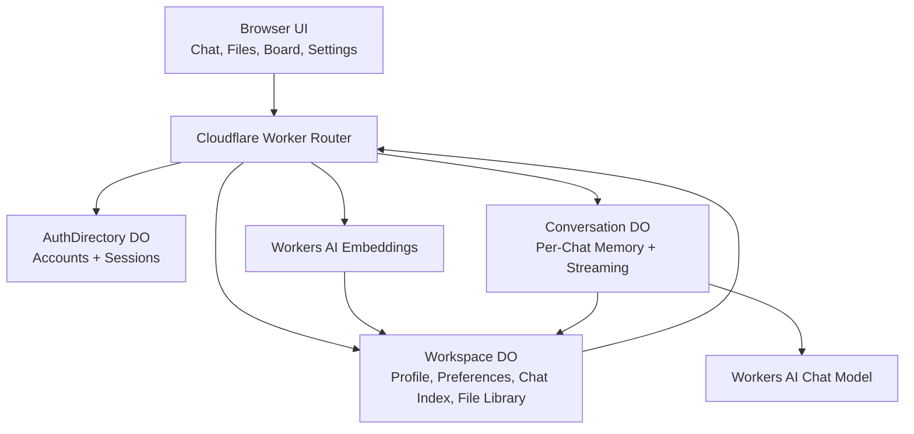
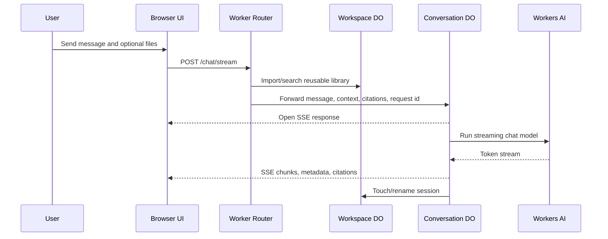

# LYTA


<p align="center">
  
</p>

<p align="center">
  <b>Edge-native AI workspace for technical work.</b><br/>
  Persistent workspaces · Reusable file memory · Retrieval with citations · Streaming chat · Output board
</p>

<p align="center">
  <a href="https://lyta.parthrohit-dev.workers.dev"><b>Live Demo</b></a> ·
  <a href="./ARCHITECTURE.md"><b>Architecture Notes</b></a>
</p>

## Overview

LYTA is a portfolio-grade AI workspace built on Cloudflare Workers, Durable Objects, and Workers AI. It is designed to demonstrate more than a prompt box: it models user state, file memory, retrieval, streaming, and output capture as a real product system.

The current product experience is intentionally minimal. The interface focuses on a quiet workspace rail, readable chat, reusable files, cited answers, and a document-style output board.

## What LYTA Does

- Starts immediately in guest mode with temporary server-backed workspace state.
- Supports account workspaces for persisted chats, files, profile data, and preferences.
- Ingests PDFs, DOCX, TXT, Markdown, CSV, JSON, HTML, XML, and images.
- Stores uploaded documents in a reusable file library instead of treating every upload as a one-off attachment.
- Retrieves relevant file snippets and returns source citations in chat and on the output board.
- Streams assistant responses over Server-Sent Events.
- Provides `Instant`, `Deep`, and `Creative` response modes.
- Generates short chat titles and follow-up prompts.
- Lets users pin strong assistant responses to a board for copy or Markdown export.

## Why This Is Technically Interesting

Most AI demos are stateless chat screens. LYTA is structured around explicit ownership boundaries:

- **Worker Router** resolves guest/account identity, validates requests, coordinates retrieval, and forwards normalized chat work.
- **AuthDirectory Durable Object** owns account records, password hashes, auth sessions, and token validation.
- **Workspace Durable Object** owns profile data, preferences, chat index, file metadata, document chunks, embeddings, and library search.
- **Conversation Durable Object** owns per-chat memory, ordered writes, summarization, title generation, follow-ups, and streaming persistence.
- **Workers AI** provides both chat generation and embedding generation.

The streaming path is hardened for demo reliability. `/chat/stream` establishes a valid SSE response before the model call runs, and model/retrieval failures degrade into clean LYTA errors instead of leaking Cloudflare 1101 HTML into the UI. Chat responses also include `X-Lyta-Request-Id` for log correlation, while logs avoid prompts, file text, emails, tokens, and full user data.

## Demo Walkthrough

1. Open the [live demo](https://lyta.parthrohit-dev.workers.dev).
2. Start as a guest and ask a technical question.
3. Upload a document and ask LYTA to summarize risks, decisions, or next steps.
4. Reuse the uploaded file from the library in another chat.
5. Compare `Instant`, `Deep`, and `Creative` response modes.
6. Pin a response to the output board and copy or download it.
7. Sign in to move from temporary guest state to a saved account workspace.

Prefer not to type your own material? [`fixtures/demo-architecture-change.md`](fixtures/demo-architecture-change.md)
is a short, clearly-fictional sample change proposal you can upload in step 3 instead — safe public
material for demoing retrieval and citations.

## Architecture

<p align="center">
  
</p>





### Core Building Blocks

| Layer | Responsibility |
| --- | --- |
| `pages/` | Vanilla HTML/CSS/JS workspace UI, uploads, auth modal, streaming chat, board |
| `src/router.ts` | Principal resolution, route validation, guest/account routing, library retrieval orchestration |
| `AuthDirectory` | Account records, password hashing, session tokens |
| `Workspace` | Profile, preferences, chat index, reusable file library, vector search |
| `Conversation` | Per-chat state, summaries, titles, follow-ups, SSE streaming, persistence |
| `services/ai.ts` / `services/embeddings.ts` | Workers AI model and embedding calls with normalized failures |

More detail lives in [ARCHITECTURE.md](./ARCHITECTURE.md).

## Feature Inventory

### Implemented

- Guest and account workspace modes
- Email/password account registration and login
- Persistent chat sessions for account workspaces
- Temporary guest sessions with isolated server-backed state
- File upload and browser-side document text extraction
- Reusable workspace file library
- Embedding-backed file retrieval with citations
- SSE streaming chat responses
- Response modes: `Instant`, `Deep`, `Creative`
- Chat title generation, summarization, and follow-up prompts
- Minimal output board with copy and Markdown download
- Request-id based chat error correlation
- Graceful degradation for AI/retrieval failures

### Known Tradeoffs

- Guest state is temporary and scoped to the guest cookie.
- Auth is email/password based, not OAuth or magic link.
- Retrieval uses Durable Object state rather than a dedicated external vector database.
- Browser-side extraction keeps the architecture compact but does not replace server-side OCR.
- The output board is a focused Markdown capture pane, not a full artifact runtime.

## Project Structure

```text
assets/
  architecture.svg         Source for the README architecture visual
  architecture.png         Rendered README architecture visual
  demo.svg                 Source for the README product preview
  demo.png                 Rendered README product preview

scripts/
  render_asset.swift       Renders SVG assets to PNG on macOS

pages/
  index.html               Main UI shell
  styles.css               Minimal workspace visual system
  app-core.js              Generated browser utility bundle
  app-attachments.js       Browser-side attachment preparation
  app.js                   Client logic for auth, chat, uploads, board, settings

pages-src/
  app-core.ts              TypeScript source for app-core.js

src/
  index.ts                 Worker entry point
  router.ts                Request orchestration and workspace routing
  auth/crypto.ts           Password and token helpers
  chat/messages.ts         Prompt shaping and message normalization
  durable/
    authDirectory.ts       Account and session storage
    workspace.ts           Workspace state, file library, preferences
    conversation.ts        Chat memory, streaming, follow-ups, summaries
  library/chunks.ts        Document chunking and citation formatting
  services/
    ai.ts                  Workers AI chat calls
    embeddings.ts          Embedding generation
    retriever.ts           Small built-in knowledge retriever
  utils/
    serverErrors.ts        Sanitized server error logging helpers
```

## Stack

- Cloudflare Workers
- Cloudflare Durable Objects
- Cloudflare Workers AI
- TypeScript
- Vanilla HTML, CSS, and browser JavaScript
- PDF.js
- Mammoth
- Server-Sent Events

## Local Development

### Requirements

- Node.js 18+
- Wrangler CLI
- macOS only for the optional SVG-to-PNG asset renderer

### Install

```bash
npm install
```

### Build Client Assets

```bash
npm run build:client
```

### Run Locally

```bash
wrangler dev --remote
```

Open:

```text
http://localhost:8787
```

### Render README Assets

```bash
swift scripts/render_asset.swift assets/demo.svg assets/demo.png 1600 960
swift scripts/render_asset.swift assets/architecture.svg assets/architecture.png 1600 900
```

## Verification

```bash
npm run format:check
npm run build:client
./node_modules/.bin/tsc --noEmit
./node_modules/.bin/tsc -p tsconfig.client.json --noEmit
node --check pages/app-core.js
node --check pages/app.js
node --check pages/app-attachments.js
git diff --check
```

Or run everything at once with `npm run check` — it's the exact gate CI and
the deploy workflow both run.

## Testing

```bash
npm run test:unit          # pure-function tests, no Durable Object involved
npm run test:integration   # drive a Durable Object's fetch() against faked storage
npm run test:eval          # scripted-model evaluation suite (eval/dataset.json)
npm run test:smoke         # register -> upload -> chat -> stream through the real router
```

`npm test` runs unit, integration, and smoke (the eval suite runs as part of
`test:integration`'s glob and separately via `test:eval` for CI visibility —
see below). Coverage areas called out in [issue #9](https://github.com/parthrohit22/lyta/issues/9):

| Area | Test file |
| --- | --- |
| Auth/session isolation | `tests/integration/abuse-controls.test.ts` |
| Rate limits | `tests/integration/abuse-controls.test.ts` |
| Streaming persistence | `tests/integration/streaming-persistence.test.ts` |
| Prompt boundaries | `tests/unit/retrieval-boundary.test.ts` |
| File lifecycle | `tests/integration/workspace-artifacts.test.ts` |
| Citation identity | `tests/unit/retrieval-boundary.test.ts`, `tests/integration/project-context.test.ts` |
| History retention | `tests/integration/conversation-history.test.ts`, `tests/integration/workspace-artifacts.test.ts` |
| Log redaction | `tests/unit/log-redaction.test.ts` |
| Full request pipeline | `tests/smoke/smoke.test.ts` |

## Model Configuration and Evaluation

Product workflows ask for a **profile**, not a model. `src/ai/registry.ts`
is the source of truth for both:

- `MODEL_REGISTRY` lists every approved model with its capabilities (text,
  vision, structured output, tool calling, streaming, embeddings), limits,
  privacy class, availability, cost policy, and evaluation result.
- `PRODUCT_PROFILES` defines the user-facing profiles `Instant`, `Deep Review`
  and `Visual Review`, and the internal `Creative` and `Embedding` profiles.
  Each one declares the capabilities it needs, the privacy classes it allows,
  its candidate models in fallback order, its timeout/retry policy, and its
  latency/cost/quality targets.

`resolveProfile()` picks the first enabled, evaluated, capability-compatible
candidate as primary and the next one as fallback. When nothing qualifies it
fails with a clear `no_compatible_model` error. Requests add their own needs:
a message with an image requires vision, so it never falls back to the
text-only 8B model, and a long prompt skips models whose context window is
too small. `src/config/modelProfiles.ts` derives the legacy per-mode
`MODEL_PROFILES` from the registry, so `getModelProfile()` callers see the
same values as before.

All calls go through `src/services/ai.ts` (`runAI`, `runAIStream`,
`runStructured`, and `createEmbedding` in `src/services/embeddings.ts`). These
call a provider-neutral `ModelProvider` adapter (`src/ai/providers/`), and
`callWithPolicy()` applies timeout, retry, fallback and cancellation.
Provider errors are normalized to one `ModelError` code set. A failed call
returns a transparent `degraded` message naming the profile, rather than
quietly switching to a model that can't do what the profile promises.
Responses carry the profile, its data-handling policy and the serving model
as metadata. `GET /models/profiles` lists the user-facing profiles in the
same shape for the UI.

Adding a model is a registry entry plus an evaluation result; see
[`docs/runbooks/provider-change.md`](docs/runbooks/provider-change.md).
`tests/unit/model-registry.test.ts` enforces the registry rules, and
`tests/unit/model-provider-contract.test.ts` runs one structured contract
against a mock provider and every adapter.

### Model gateway (Cloudflare AI Gateway)

Gateway routing is optional and off by default:

| Setting | Kind | Effect |
| --- | --- | --- |
| `AI_GATEWAY_ID` | Worker var | Gateway name. When set, every Workers AI call (chat, streaming, structured output, embeddings, and route-level `env.AI.run` calls) uses the binding's `gateway` option. |
| `AI_GATEWAY_REQUIRED` | Worker var | `"true"` makes a missing or invalid `AI_GATEWAY_ID` fail closed (`not_configured`) instead of calling Workers AI directly. Set it in production once the gateway exists. |
| `AI_EXTERNAL_PROVIDERS` | Worker var | `"enabled"` allows external-provider registry entries. It has no effect without a gateway, and the only external entry ships disabled. |
| `AI_EXTERNAL_PROVIDER_KEY` | Worker secret | Only needed if an external provider's key isn't stored in the gateway (BYOK). Set it with `wrangler secret put`, never in `wrangler.jsonc`. |

With no `AI_GATEWAY_ID`, LYTA calls Workers AI directly. That is the
documented path for local development (`wrangler dev`) and for the test
suites. To try the gateway path, create a gateway in the Cloudflare dashboard
(AI → AI Gateway), then add a var:

```bash
npx wrangler dev --remote --var AI_GATEWAY_ID:<your-gateway-name>
```

Every gateway request sends `collectLog: false` (the gateway keeps no
prompt/response log), `skipCache: true`, the profile's `requestTimeoutMs`, and
`retries.maxAttempts: 1`, because retries and capability-aware fallback stay
in the Worker. It also sends four metadata fields: `profile`, `route`, a hashed
`workspace` tag, and `attempt`. Each call also writes one content-free
`[lyta-operation]` log line with profile, provider, model, workspace tag,
latency, retry/fallback, error code and estimated cost, which gives
per-workspace and per-profile cost, latency and error attribution without
source text or credentials. Gateway-side rate limits are configured on the
gateway itself; LYTA's per-identity limiter still applies either way.

**Verification status:** the gateway path is covered by unit tests against a
mocked `AI` binding. No real gateway has been created for LYTA yet, so it has
not been exercised end to end. Operating procedures live in
[`docs/runbooks/`](docs/runbooks/README.md).

### Evaluation

`eval/dataset.json` is a versioned evaluation baseline (citation accuracy,
insufficient-evidence compliance, cross-mode sanity checks) that CI runs on
every PR as a pipeline-correctness regression gate. See
[`eval/README.md`](eval/README.md) for what that suite does and doesn't
prove, and the model-promotion policy: no model or prompt change is called
"stronger" until it beats the documented baseline against this suite, run
against a real model.

## CI/CD

GitHub Actions runs formatting, the client build, unit tests, integration
tests, the evaluation suite, the smoke test, TypeScript checks, browser
bundle syntax checks, a generated-client consistency check, a production
dependency audit, a model/prompt configuration change report, and a Worker
deployment bundle validation as separate steps for every pull request and
merge to `main` (`npm run check` runs the same gates locally in one
command).

Production deployment is deliberately manual through the **Deploy production**
workflow. Protect the repository's `production` environment with required
reviewers, then add these environment secrets:

- `CLOUDFLARE_API_TOKEN` — scoped to deploy this Worker and write to its R2 bucket.
- `CLOUDFLARE_ACCOUNT_ID` — the Cloudflare account that owns LYTA.

The workflow never prints either value. It installs from `package-lock.json`,
reruns the complete quality gate, and only then calls Wrangler to deploy.
Before dispatching it, walk through [`RELEASE_CHECKLIST.md`](RELEASE_CHECKLIST.md)
for the things CI can't verify automatically — deployed-header verification,
migration review, an AI-evaluation comparison, and a manual accessibility
smoke test.

## Project Context and Provenance

LYTA stores workspace source payloads in private R2 objects and treats chunks,
findings, decisions, and user-approved summaries as provider-independent
context. A model request receives only retrieval-selected evidence, never a
full workspace dump. Each selection creates an ID-only context manifest with a
policy version; it contains no source text or query.

Authenticated workspace APIs support inspection and management:

- `GET /context` lists context metadata; add `?includeContent=true` to inspect
  saved findings, decisions, and summaries.
- `POST /context/records` creates or updates a finding, decision, or approved
  summary with source/chunk provenance.
- `POST /context/records/delete` deletes a saved context record.
- `GET /context/manifests` lists non-sensitive selection audit records.

Deleting a source also removes derived context records linked to that source
and returns the affected-record count. Historical ID-only manifests remain as
audit evidence; deleted source text is not retrievable.

## Roadmap Ideas

- OCR for scanned PDFs and image-heavy documents
- Web research mode with explicit external citations
- Shareable board outputs or published artifact pages
- OAuth or magic-link authentication
- Retrieval quality metrics and latency dashboards
- Richer artifact generation beyond Markdown export

## Repo Quality Goals

LYTA is structured to be readable by reviewers:

- clear product story and live demo path
- explicit state ownership boundaries
- architecture diagrams that match implementation
- minimal frontend without framework overhead
- failure handling that preserves product polish during AI or retrieval issues
