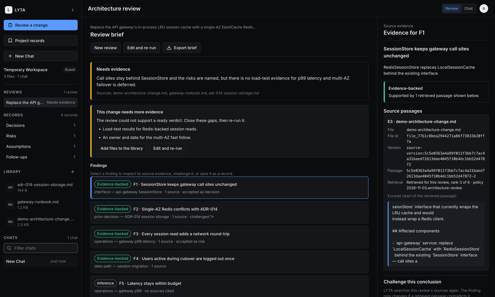
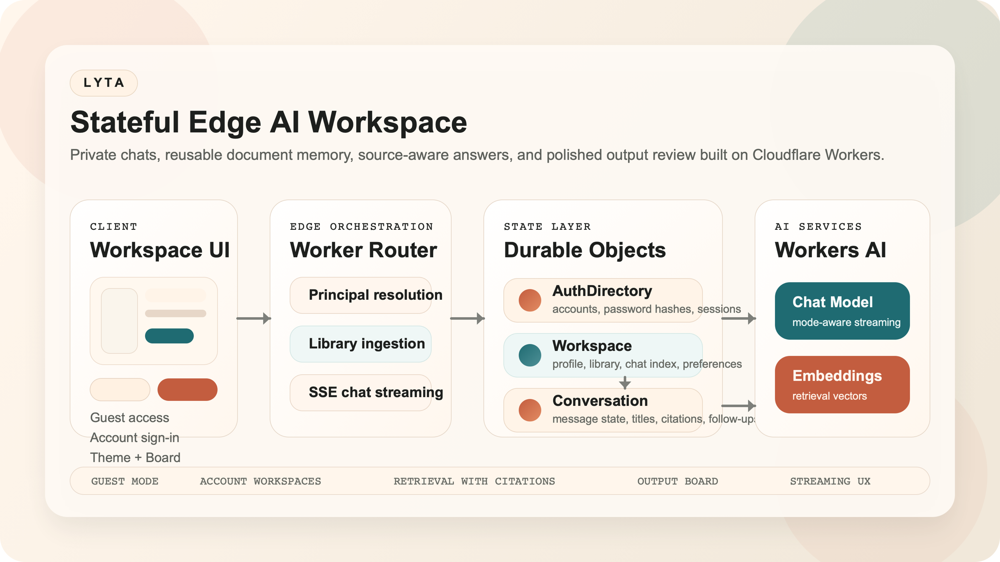
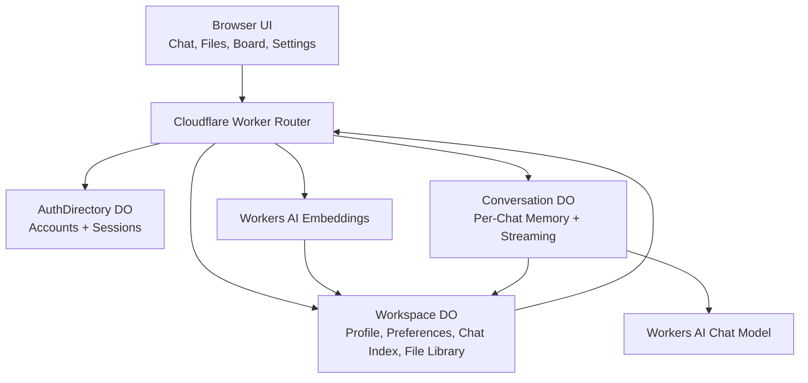
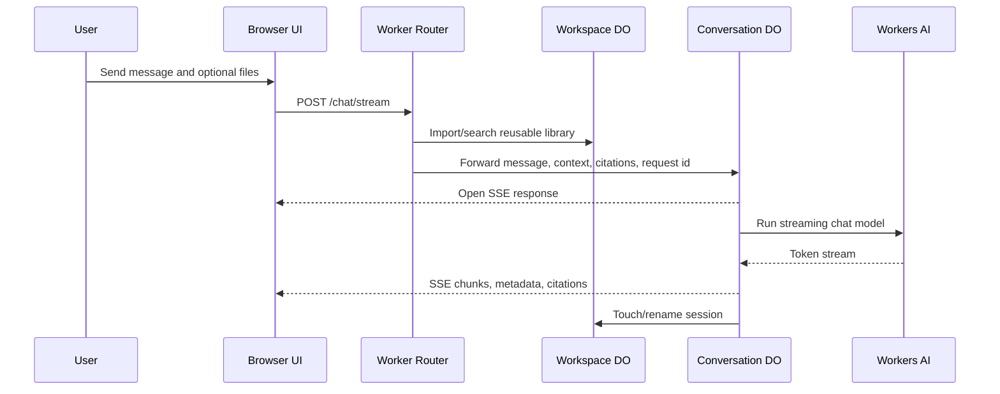

# LYTA


<p align="center">
  
</p>

<p align="center">
  <b>Edge-native AI workspace for technical work.</b><br/>
  Architecture change review · Drift detection · Source evidence for every claim · Decision records · Reusable file memory · Streaming chat
</p>

<p align="center">
  <a href="https://lyta.parthrohit-dev.workers.dev"><b>Live Demo</b></a> ·
  <a href="./ARCHITECTURE.md"><b>Architecture Notes</b></a>
</p>

## Overview

LYTA is a portfolio-grade AI workspace built on Cloudflare Workers, Durable Objects, and Workers AI. It is designed to demonstrate more than a prompt box: it models user state, file memory, retrieval, streaming, and output capture as a real product system.

The current product experience is intentionally minimal. The interface focuses on a quiet workspace rail, readable chat, reusable files, cited answers, and a document-style output board.

## What LYTA Does

- **Review workspace**: the review brief is the centre panel, the selected claim's exact source passage (file, version, passage id, retrieval rank and policy, evidence state) sits beside it, and reviews, decision/risk/assumption/follow-up records, and files live in the sidebar. Chat is one switch away. Built on a documented design system ([`docs/design/design-system.md`](docs/design/design-system.md)) with automated contrast, label, focus, and live-region checks.
- **Architecture Change Review**: paste a proposed technical change, pick the library files to check it against, and get a structured review brief instead of a chat reply — a `ready` / `needs evidence` / `blocked` verdict with rationale, findings classified as evidence-backed, inference, recommendation, or insufficient evidence, source excerpts for every citation, per-finding accept/reject/unresolved dispositions, and a Markdown export.
- **Drift detection**: click **Check drift**, give each library file one role (specification/PRD, architecture/design, or implementation evidence), and LYTA checks four documented drift rules: a requirement with no supporting architecture or code passage, an architecture component with no implementation passage, an interface or constraint contradiction cited on both sides, and stale or missing source evidence. Every run records the version and import date of each source it compared. Each finding shows the claim, the conflicting or missing counterpart, exact passage references, and a confidence; a missing counterpart is always "not found in the supplied evidence", never "does not exist in the project". Re-running shows new, unchanged, and resolved findings by stable key without rewriting earlier runs, and confirmed / accepted-deviation / false-positive / needs-investigation dispositions carry across runs.
- Starts immediately in guest mode with temporary server-backed workspace state.
- Supports account workspaces for persisted chats, files, profile data, and preferences.
- Ingests PDFs, DOCX, TXT, Markdown, CSV, JSON, HTML, XML, and images.
- Stores uploaded documents in a reusable file library instead of treating every upload as a one-off attachment.
- Retrieves relevant file snippets and returns source citations in chat and on the output board.
- Streams assistant responses over Server-Sent Events.
- Provides `Instant`, `Deep`, and `Creative` response modes.
- Generates short chat titles and follow-up prompts.
- Lets users pin strong assistant responses to a board for copy or Markdown export.

## Why This Is Technically Interesting

Most AI demos are stateless chat screens. LYTA is structured around explicit ownership boundaries:

- **Worker Router** resolves guest/account identity, validates requests, coordinates retrieval, and forwards normalized chat work.
- **AuthDirectory Durable Object** owns account records, password hashes, auth sessions, and token validation.
- **Workspace Durable Object** owns profile data, preferences, chat index, file metadata, document chunks, embeddings, and library search.
- **Conversation Durable Object** owns per-chat memory, ordered writes, summarization, title generation, follow-ups, and streaming persistence.
- **Workers AI** provides both chat generation and embedding generation.

The streaming path is hardened for demo reliability. `/chat/stream` establishes a valid SSE response before the model call runs, and model/retrieval failures degrade into clean LYTA errors instead of leaking Cloudflare 1101 HTML into the UI. Chat responses also include `X-Lyta-Request-Id` for log correlation, while logs avoid prompts, file text, emails, tokens, and full user data.

## Demo Walkthrough

1. Open the [live demo](https://lyta.parthrohit-dev.workers.dev).
2. Start as a guest and ask a technical question.
3. Upload a document and ask LYTA to summarize risks, decisions, or next steps.
4. Reuse the uploaded file from the library in another chat.
5. Compare `Instant`, `Deep`, and `Creative` response modes.
6. Pin a response to the output board and copy or download it.
7. Click **Review a change** in the sidebar, describe a proposed change and its intended outcome, select
   the uploaded file as an evidence source, and run the review. Open a finding to inspect its source
   excerpt, challenge a conclusion, save findings as decisions or risks (see **Project records**), then
   export the brief as Markdown. [`docs/demo/review-walkthrough.md`](docs/demo/review-walkthrough.md)
   is the full demo and usability script.
8. Click **Check drift**, upload the three Lanternfish files from [`fixtures/drift/`](fixtures/drift/)
   (a PRD, an architecture note, and the v1 code export), give each its role, and run the check.
   Then upload the v2 code export (same file name), choose **Re-run with changed sources**, switch the
   implementation role to the newer file, and compare: one finding unchanged, one new, two resolved.
   Mark a finding as an accepted deviation and re-run again to see the disposition carried over.
   The [drift section of the walkthrough](docs/demo/review-walkthrough.md#drift-check) has the full script.
9. Sign in to move from temporary guest state to a saved account workspace.

Prefer not to type your own material? [`fixtures/demo-architecture-change.md`](fixtures/demo-architecture-change.md)
is a short, clearly-fictional sample change proposal you can upload in step 3 and review in step 7 —
safe public material for demoing retrieval, citations, and Architecture Change Review.

## Architecture

<p align="center">
  
</p>





### Core Building Blocks

| Layer | Responsibility |
| --- | --- |
| `pages/` | Vanilla HTML/CSS/JS workspace UI, uploads, auth modal, streaming chat, board |
| `src/router.ts` | Principal resolution, route validation, guest/account routing, library retrieval orchestration |
| `AuthDirectory` | Account records, password hashing, session tokens |
| `Workspace` | Profile, preferences, chat index, reusable file library, vector search |
| `Conversation` | Per-chat state, summaries, titles, follow-ups, SSE streaming, persistence |
| `services/ai.ts` / `services/embeddings.ts` | Workers AI model and embedding calls with normalized failures |

More detail lives in [ARCHITECTURE.md](./ARCHITECTURE.md).

## Feature Inventory

### Implemented

- Guest and account workspace modes
- Email/password account registration and login
- Persistent chat sessions for account workspaces
- Temporary guest sessions with isolated server-backed state
- File upload and browser-side document text extraction
- Reusable workspace file library
- Embedding-backed file retrieval with citations
- SSE streaming chat responses
- Response modes: `Instant`, `Deep`, `Creative`
- Chat title generation, summarization, and follow-up prompts
- Minimal output board with copy and Markdown download
- Request-id based chat error correlation
- Graceful degradation for AI/retrieval failures
- Architecture Change Review: source-scoped evidence retrieval, a strictly validated JSON review
  contract, readiness verdicts, classified findings with citations, "challenge this conclusion"
  counter-evidence search with history, accepted findings saved as decision/risk/assumption/follow-up
  records, and Markdown brief export
- Drift detection: three explicit source roles, per-role scoped retrieval, four bounded rules with a
  strictly validated contract, deterministic stale/missing-source checks, run history with a stored
  new/unchanged/resolved diff, dispositions kept by stable finding key, and Markdown export

### Known Tradeoffs

- Guest state is temporary and scoped to the guest cookie.
- Auth is email/password based, not OAuth or magic link.
- Retrieval uses Durable Object state rather than a dedicated external vector database.
- Browser-side extraction keeps the architecture compact but does not replace server-side OCR.
- The output board is a focused Markdown capture pane, not a full artifact runtime.
- Drift and review prompts see the first 260 characters of each retrieved passage (`src/library/chunks.ts`),
  up to six passages per drift role. Long documents need focused scopes, which is why the drift fixtures
  are compact registers.

## Project Structure

```text
assets/
  architecture.svg         Source for the README architecture visual
  architecture.png         Rendered README architecture visual
  demo.png                 README hero: a real screenshot of the review workspace (see below)

scripts/
  render_asset.swift       Renders SVG assets to PNG on macOS
  demo-preview.ts          Local UI preview on scripted fakes (no Cloudflare account needed)

docs/
  design/design-system.md  Tokens, components, states, breakpoints, accessibility rules
  demo/review-walkthrough.md  Demo and usability script for the review and drift flows

fixtures/
  demo-architecture-change.md  Fictional change proposal for the review demo
  drift/                   Fictional Lanternfish PRD, architecture note, and v1/v2 code exports

pages/
  index.html               Main UI shell
  styles.css               Minimal workspace visual system
  app-core.js              Generated browser utility bundle
  app-attachments.js       Browser-side attachment preparation
  app.js                   Client logic for auth, chat, uploads, board, settings
  app-review-core.js       Generated review helper bundle
  app-review.js            Review workspace: brief, evidence inspector, records, view switch
  app-drift-core.js        Generated drift helper bundle
  app-drift.js             Drift checks: role picker, run view with diff badges, dispositions

pages-src/
  app-core.ts              TypeScript source for app-core.js
  app-review-core.ts       TypeScript source for app-review-core.js
  app-drift-core.ts        TypeScript source for app-drift-core.js

src/
  index.ts                 Worker entry point
  router.ts                Request orchestration and workspace routing
  auth/crypto.ts           Password and token helpers
  chat/messages.ts         Prompt shaping and message normalization
  durable/
    authDirectory.ts       Account and session storage
    workspace.ts           Workspace state, file library, preferences
    conversation.ts        Chat memory, streaming, follow-ups, summaries
  library/chunks.ts        Document chunking and citation formatting
  review/
    contract.ts            Review input/output contract and strict output validation
    prompt.ts              JSON review prompt over untrusted, source-scoped evidence
    brief.ts               Markdown review brief export
  drift/
    contract.ts            Drift rules, input validation, strict output validation, run diffing
    prompt.ts              JSON drift prompt over role-labelled, untrusted evidence
    brief.ts               Markdown drift report export
  services/
    ai.ts                  Workers AI chat calls
    embeddings.ts          Embedding generation
    retriever.ts           Small built-in knowledge retriever
  utils/
    serverErrors.ts        Sanitized server error logging helpers
```

## Stack

- Cloudflare Workers
- Cloudflare Durable Objects
- Cloudflare Workers AI
- TypeScript
- Vanilla HTML, CSS, and browser JavaScript
- PDF.js
- Mammoth
- Server-Sent Events

## Local Development

### Requirements

- Node.js 18+
- Wrangler CLI
- macOS only for the optional SVG-to-PNG asset renderer

### Install

```bash
npm install
```

### Build Client Assets

```bash
npm run build:client
```

### Run Locally

```bash
wrangler dev --remote
```

Open:

```text
http://localhost:8787
```

### Preview the UI Without Cloudflare

`scripts/demo-preview.ts` serves `pages/` and runs the real router and
Durable Objects against in-memory storage and a scripted model. `SEED=1`
pre-builds a demo workspace (the fixture, a runbook, an ADR, a review, a
challenge, records, and a two-run Lanternfish drift check). Nothing persists,
and every model reply is canned.

```bash
npm run build:client
SEED=1 npx tsx scripts/demo-preview.ts
```

Open `http://localhost:8799`.

### Render README Assets

The hero image is a real screenshot of the seeded preview, captured with
headless Chrome in dark mode while the preview above is running:

```bash
"/Applications/Google Chrome.app/Contents/MacOS/Google Chrome" --headless=new --hide-scrollbars --force-dark-mode --window-size=1600,960 --force-device-scale-factor=2 --virtual-time-budget=8000 --screenshot="$PWD/assets/demo.png" http://localhost:8799/
```

```bash
swift scripts/render_asset.swift assets/architecture.svg assets/architecture.png 1600 900
```

## Verification

```bash
npm run format:check
npm run build:client
./node_modules/.bin/tsc --noEmit
./node_modules/.bin/tsc -p tsconfig.client.json --noEmit
node --check pages/app-core.js
node --check pages/app.js
node --check pages/app-attachments.js
git diff --check
```

Or run everything at once with `npm run check` — it's the exact gate CI and
the deploy workflow both run.

## Testing

```bash
npm run test:unit          # pure-function tests, no Durable Object involved
npm run test:integration   # drive a Durable Object's fetch() against faked storage
npm run test:eval          # scripted-model pipeline suite + model-eval dataset and promotion gate
npm run test:smoke         # register -> upload -> chat -> stream through the real router
```

`npm test` runs unit, integration, and smoke (the eval suite runs as part of
`test:integration`'s glob and separately via `test:eval` for CI visibility —
see below). Coverage areas called out in [issue #9](https://github.com/parthrohit22/lyta/issues/9):

| Area | Test file |
| --- | --- |
| Auth/session isolation | `tests/integration/abuse-controls.test.ts` |
| Rate limits | `tests/integration/abuse-controls.test.ts` |
| Streaming persistence | `tests/integration/streaming-persistence.test.ts` |
| Prompt boundaries | `tests/unit/retrieval-boundary.test.ts` |
| File lifecycle | `tests/integration/workspace-artifacts.test.ts` |
| Citation identity | `tests/unit/retrieval-boundary.test.ts`, `tests/integration/project-context.test.ts` |
| History retention | `tests/integration/conversation-history.test.ts`, `tests/integration/workspace-artifacts.test.ts` |
| Log redaction | `tests/unit/log-redaction.test.ts` |
| Full request pipeline | `tests/smoke/smoke.test.ts` |
| Architecture Change Review (happy, missing-evidence, conflicting, inaccessible-source paths) | `tests/integration/architecture-review.test.ts`, `tests/unit/review-contract.test.ts` |
| Review challenges and project records (changed, unchanged, insufficient counter-evidence) | `tests/integration/review-challenge.test.ts`, `tests/unit/review-contract.test.ts` |
| Drift detection (each rule, not found vs does not exist, stale/missing sources, re-run diffing, disposition persistence, unsupported comparison types, malformed output, source deletion) | `tests/integration/drift-detection.test.ts`, `tests/unit/drift-contract.test.ts` |
| Drift rule precision and citation identity (scored per rule against `eval/dataset.json`) | `tests/integration/eval-suite.test.ts` |
| Cross-model evaluation: fixture schema, scoring, promotion gate, eval-only route (scripted backend; no real model) | `tests/integration/model-eval.test.ts`, `tests/unit/eval-score.test.ts`, `tests/unit/eval-gate.test.ts`, `tests/unit/eval-route.test.ts` |
| Frontend accessibility (labels, names, id references, landmarks, live regions, focus, reduced motion, WCAG contrast for both themes, announcement and evidence-state text, no raw HTML in review or drift UI) | `tests/unit/frontend-accessibility.test.ts` |

## Model Configuration and Evaluation

`src/config/modelProfiles.ts` is the single source of truth for per-mode
model selection: model id, version label, timeout, retry budget, fallback
model, and documented latency/cost/quality targets for `Instant` and `Deep`
(`Deep Review`). `src/services/ai.ts`'s `callWithPolicy()` wraps every
Workers AI call with that timeout/retry/fallback policy and records the
outcome as non-sensitive telemetry (model, version, retry count, fallback
used, timed out) — never prompt or response content.

`eval/dataset.json` is a versioned evaluation baseline (citation accuracy,
insufficient-evidence compliance, cross-mode sanity checks) that CI runs on
every PR as a pipeline-correctness regression gate. See
[`eval/README.md`](eval/README.md) for what that suite does and doesn't
prove.

Model choice is governed by the cross-model evaluation in
[`eval/README.md`](eval/README.md#cross-model-evaluation-and-promotion-policy):
27 synthetic fixtures across Architecture Change Review, Drift Detection and
adversarial sources (`eval/fixtures/`), a pure scorer (`src/eval/score.ts`)
for evidence precision/recall, citation correctness, unsupported-claim rate,
structured-output validity, latency and estimated cost, documented thresholds
(`eval/thresholds.json`), and a promotion gate that also fails any regression
on a trust fixture. `npm run eval:run` runs the baseline and every candidate
on the same prompts, either against a scripted backend (CI) or against Workers
AI through an eval-only route on a local `wrangler dev --remote` Worker. **No
real-model run has been recorded yet**, so the baseline-vs-candidates table is
pending.

## CI/CD

GitHub Actions runs formatting, the client build, unit tests, integration
tests, the evaluation suite, the smoke test, TypeScript checks, browser
bundle syntax checks, a generated-client consistency check, a production
dependency audit, a model/prompt configuration change report, a routing guard
that requires a passing real-model evaluation report for any newly routed model, and a Worker
deployment bundle validation as separate steps for every pull request and
merge to `main` (`npm run check` runs the same gates locally in one
command).

Production deployment is deliberately manual through the **Deploy production**
workflow. Protect the repository's `production` environment with required
reviewers, then add these environment secrets:

- `CLOUDFLARE_API_TOKEN` — scoped to deploy this Worker and write to its R2 bucket.
- `CLOUDFLARE_ACCOUNT_ID` — the Cloudflare account that owns LYTA.

The workflow never prints either value. It installs from `package-lock.json`,
reruns the complete quality gate, and only then calls Wrangler to deploy.
Before dispatching it, walk through [`RELEASE_CHECKLIST.md`](RELEASE_CHECKLIST.md)
for the things CI can't verify automatically — deployed-header verification,
migration review, an AI-evaluation comparison, and a manual accessibility
smoke test.

## Project Context and Provenance

LYTA stores workspace source payloads in private R2 objects and treats chunks,
findings, decisions, and user-approved summaries as provider-independent
context. A model request receives only retrieval-selected evidence, never a
full workspace dump. Each selection creates an ID-only context manifest with a
policy version; it contains no source text or query.

Authenticated workspace APIs support inspection and management:

- `GET /context` lists context metadata; add `?includeContent=true` to inspect
  saved findings, decisions, and summaries.
- `POST /context/records` creates or updates a finding, decision, risk,
  assumption, follow-up, or approved summary with source/chunk provenance.
- `POST /context/records/delete` deletes a saved context record.
- `GET /context/manifests` lists non-sensitive selection audit records.

Deleting a source also removes derived context records linked to that source
and returns the affected-record count. Historical ID-only manifests remain as
audit evidence; deleted source text is not retrievable.

## Architecture Change Review

A review is a separate workflow from chat, with its own contract
(`src/review/contract.ts`):

- `POST /reviews` takes `proposedChange`, `intendedOutcome`, optional
  `constraints`, and `sourceFileIds` (1–8 library files). Retrieval is scoped to
  those files only; an id that is not in the caller's library (deleted, or
  another workspace's) is refused with `409` before the model runs. The `Deep`
  model profile is called through `callWithPolicy()` with a JSON-only prompt,
  and the retrieval writes a context manifest under policy
  `2026-11-03.architecture-review`.
- The model's JSON is validated strictly. Malformed output (not JSON, unknown
  readiness or classification, missing rationale or findings) returns `502` and
  nothing is stored. Grounding problems are corrected and recorded in
  `adjustments`: citations not in the retrieved evidence are dropped, an
  `evidence-backed` finding with no valid citation becomes `inference`, a
  conflict needs two distinct retrieved chunks, and `ready` is lowered to
  `needs evidence` when there is no evidence, no evidence-backed finding, or an
  unreconciled conflict.
- `GET /reviews` lists reviews; `GET /reviews/:id` returns one.
- `POST /reviews/:id/findings/:findingId` with `{ "disposition": "accepted" |
  "rejected" | "unresolved", "note"? }` records a disposition. Accepting a
  finding saves it as a `finding` context record with chunk-level provenance;
  any other disposition removes that record.
- `GET /reviews/:id/export` returns a Markdown brief with the readiness verdict,
  finding classifications and dispositions, challenge history, source file
  names, and excerpts.
- `POST /reviews/:id/findings/:findingId/challenge` with `{ "reason"? }`
  ("Challenge this conclusion") searches the review's own sources for
  counter-evidence to one finding and validates the model's verdict with the
  same contract: `upheld`, `revised`, `withdrawn`, or `insufficient evidence`.
  A conclusion only changes when the reply cites retrieved counter-evidence;
  with nothing retrieved the model is not called. Every challenge is appended
  to the finding's history with its before/after state, and a changed
  conclusion clears the old disposition and its record.

Accepted findings become project records. The disposition body takes
`recordAs: "finding" | "decision" | "risk" | "assumption" | "follow-up"`, and
the record is stored as a canonical context record with chunk provenance and a
link back to its review. **Project records** in the sidebar lists them by kind
(`GET /context?includeContent=true`).

Reviews also return `assumptions`, `openQuestions`, and `nextActions`.

A demo and usability script for upload → review → inspect evidence →
challenge → export lives in [`docs/demo/review-walkthrough.md`](docs/demo/review-walkthrough.md).

Deleting a cited source clears its excerpts from stored reviews (the brief then
says the source was deleted) and invalidates accepted findings that depended
on it.

## Drift Detection

Drift detection is the second review workflow. It reuses the review
architecture (scoped retrieval, one `Deep` call through `callWithPolicy()`,
strict output validation with recorded `adjustments`, Markdown export, and the
same evidence inspector) with its own contract in `src/drift/contract.ts`.

| Rule | Id | What it reports | Who decides | Highest confidence |
| --- | --- | --- | --- | --- |
| D1 | `requirement-without-support` | A requirement cited from the specification with no supporting architecture or implementation passage | Model, validated | medium |
| D2 | `component-without-implementation` | A component cited from the architecture with no implementation passage | Model, validated | medium |
| D3 | `interface-contradiction` | An interface, value, limit, or constraint two roles state differently, cited on both sides | Model, validated | high |
| D4 | `stale-or-missing-source` | A role with no retrieved passage, or a selected source superseded by a newer same-name library file | Server, deterministic | high |

- `POST /drift` takes `comparisonType` (only `spec-architecture-implementation`
  is supported), a `scope`, `sources` mapping each role to 1–6 library file ids
  (a file can have only one role), and optional `rules`. An unsupported
  comparison type, role, or rule is refused with `400` and a message listing
  what is supported. Retrieval runs per role, specification first, and each
  retrieval writes a context manifest under policy `2026-11-04.drift.<role>`.
- Every run stores each source's role, file, `sourceVersionId`, and import date.
- Validation: citations not in the retrieved set are dropped; a D1 claim must
  cite a specification passage and a D2 claim an architecture passage, or the
  finding is dropped; a D3 contradiction needs both sides cited from two
  different roles; model-proposed D4 findings and unselected rules are dropped;
  an unknown rule or confidence is malformed (`502`, nothing saved).
- Absence is never presented as a fact about the project. For D1 and D2 the
  counterpart text is always written by the server and says what was searched
  ("Not found in the supplied evidence. LYTA searched N passages from …"). Model
  wording that claims something "does not exist" or "is not implemented" is
  removed and the removal recorded; a claim worded that way is dropped.
  Absence findings are capped at `medium` confidence, and drop to `low` when a
  searched role returned nothing or the model cited the counterpart it called
  missing. With no specification or architecture passage at all, the model is
  not called and only D4 runs.
- `POST /drift/:id/runs` re-runs a comparison with the same scope and rules and
  new or unchanged `sources`. Each run is written once under its own key; the
  diff against the previous run (`new`, `unchanged`, `resolved` by stable
  `rule:subject` key) is stored on the new run only, so earlier runs read back
  exactly as saved. "Resolved" means the previous run reported it and this one
  did not, which the UI and export say is not proof of a fix.
- `POST /drift/:id/dispositions` with `{ runId, findingKey, disposition, note? }`
  records `confirmed`, `accepted-deviation`, `false-positive`,
  `needs-investigation`, or `undecided` on the comparison by key, with history,
  so every later run shows it.
- `GET /drift`, `GET /drift/:id` (latest run), `GET /drift/:id/runs/:runId`, and
  `GET /drift/:id/runs/:runId/export` (Markdown report).

Deleting a source clears its excerpts from stored drift runs, as for reviews;
finding text and citation ids stay so the run history remains auditable.

## Roadmap Ideas

- OCR for scanned PDFs and image-heavy documents
- Web research mode with explicit external citations
- Shareable board outputs or published artifact pages
- OAuth or magic-link authentication
- Retrieval quality metrics and latency dashboards
- Richer artifact generation beyond Markdown export

## Repo Quality Goals

LYTA is structured to be readable by reviewers:

- clear product story and live demo path
- explicit state ownership boundaries
- architecture diagrams that match implementation
- minimal frontend without framework overhead
- failure handling that preserves product polish during AI or retrieval issues
