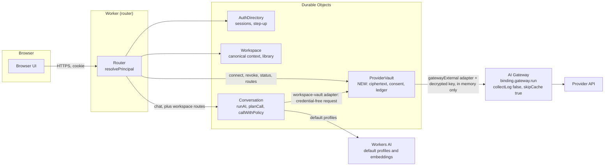
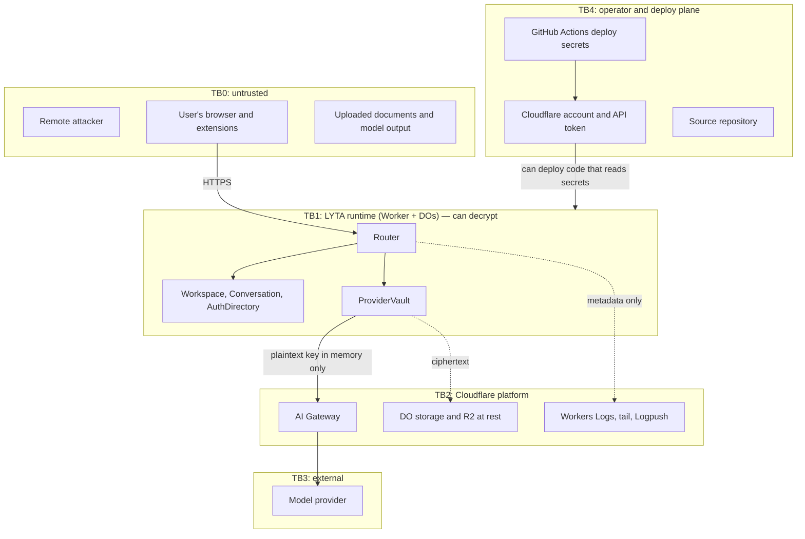
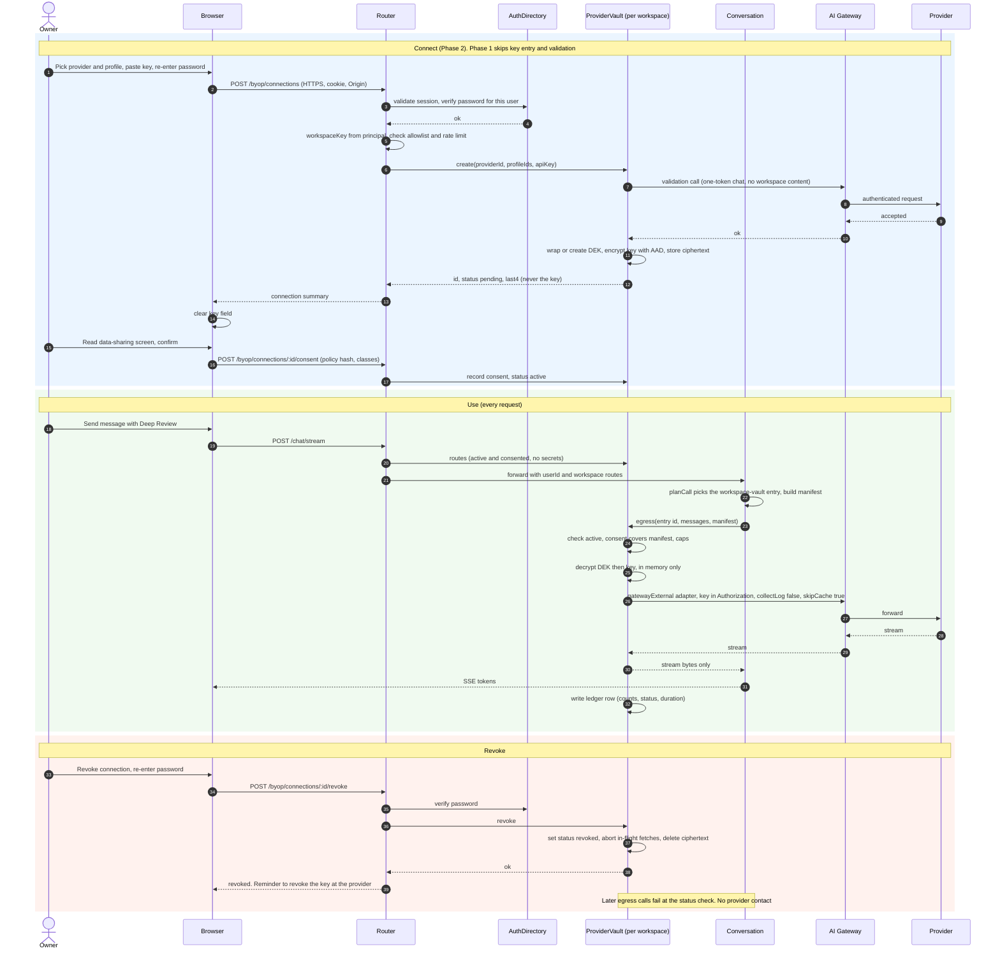

# Design: Bring Your Own Provider (BYOP) without exposing credentials

| | |
| --- | --- |
| Issue | [#15](https://github.com/parthrohit22/lyta/issues/15) (tracking: #17) |
| Status | **Draft for review. Design only, no implementation.** |
| Date | 2026-11-03 |
| Depends on | #13 (provider/capability registry) and #14 (AI Gateway control plane), as implemented in PR #32. Section 4 uses that PR's names |
| Author's caveat | The threat model below is the author's own. Acceptance criterion 7 requires a review by someone else before any user-managed key is enabled in production (see [section 13](#13-acceptance-criteria-map)). |

## 0. Summary of the decisions

1. **Credentials live in one place: a per-workspace `ProviderVault` Durable Object**, encrypted at the application layer (AES-256-GCM, per-workspace data-encryption key, wrapped by a key-encryption key held as a Workers Secret). The `Workspace` and `Conversation` objects, R2, logs and the browser never hold a credential or a decryption key.
2. **The vault makes the outbound call itself.** The decrypted key never leaves the vault's isolate: `Conversation` hands the vault a neutral, credential-free request and gets a response stream back. This is the main design choice; it costs one extra hop and buys a small, auditable surface (section 6.3).
3. **BYOP is a new path through the existing #13/#14 gate, not a parallel one.** It adds a `workspace-vault` provider id, a `credentialSource` on registry entries and a workspace-aware step in `resolveProfile()`. Calls still go through `runAI`, `callWithPolicy`, `createGatewayExternalProvider` and `buildGatewayOptions` from PR #32, behind the same `AI_EXTERNAL_PROVIDERS` and gateway conditions (section 4).
4. **Consent is enforced server-side, in the vault, at egress time** — not only in the UI. No matching consent record for the current policy text and content classes means no outbound request.
5. **Rollout is two steps**: Phase 1 is operator-provisioned (no key ever typed into the browser); Phase 2 is a narrow, allowlisted user beta where the key is entered once over HTTPS and never returned.
6. **Honest limit**: envelope encryption protects against storage-level exposure and cross-workspace bugs. It does **not** protect against malicious Worker code, a compromised deploy token, or Cloudflare account takeover, because the Worker must be able to decrypt in order to work. Section 5.3 states this plainly and section 11 is written around it.

## 1. What exists today (and what that means for BYOP)

This section is grounded in the code at `main` (commit `7c1dd28`), not in the roadmap.

| Area | Today | Consequence for BYOP |
| --- | --- | --- |
| Accounts | `AuthDirectory` is one global DO (`idFromName("global")`, `src/router.ts` `getAuthDirectoryStub`). Users are `user:{email}`, sessions are `session:{sha256(token)}` with a 30-day TTL (`src/durable/authDirectory.ts`). | Good: session tokens are stored hashed, so an `AuthDirectory` storage dump does not yield usable cookies. |
| Password hashing | PBKDF2-SHA-256, 100,000 iterations, 16-byte salt (`src/auth/crypto.ts`). Comparison is `hash === record.hash`, not constant time. | The iteration count is below current OWASP guidance and is a Workers CPU trade-off the code already documents. The non-constant-time compare is low risk (the attacker does not control the derived hash, so there is no usable timing oracle) but is a one-line fix to make before this ships. |
| Session control | Sessions are keyed only by token hash. There is **no per-user session index**, no "log out everywhere", no password change/reset, no email verification, no MFA. | Incident response needs "kill every session for user X" and BYOP management needs step-up authentication. Neither exists. Both are prerequisites (P1, P2 below). |
| Principals | `resolvePrincipal` yields `workspaceKey = user.id` for accounts and `guest:{cookie}` for guests (`src/router.ts`). The client never supplies a workspace key; the router derives it from the cookie. | This is exactly the property BYOP scoping needs: derive the vault address from the authenticated principal only (section 9). Guests are excluded from BYOP. |
| Cookies | `HttpOnly; SameSite=Lax; Secure` when HTTPS (`src/utils/cookies.ts`). | Cookie not readable from JS. `Lax` stops most cross-site POSTs but is not a CSRF design; BYOP mutations add an `Origin` check and step-up auth. |
| Workspace state | `Workspace` DO stores profile, preferences, sessions, library files, `libraryChunks` (vectors), `projectContextRecords`, `contextSelectionManifests` under plain keys, loaded as whole arrays (`src/durable/workspace.ts`). | The most feature-rich object with the most serialisation paths (bootstrap, library, context, future exports). That is a reason **not** to put secrets in it: any new "return the whole record" path would carry them. |
| R2 | One bucket, `ARTIFACTS`, object keys `workspaces/{scope}/artifacts/{fileId}/{signature}`, JSON bodies with extracted text or image data URLs; no object-level encryption (`workspace.ts`, `wrangler.jsonc`). | R2 holds the *content* that could be sent to a provider. BYOP stores nothing in R2. The bucket is named `lyta-artifacts-preview` in both `bucket_name` and `preview_bucket_name`; whether production really uses a preview bucket is out of scope here but is worth confirming (open question Q10). |
| Model calls | On `main`, `runAI`/`runAIStream` in `src/services/ai.ts` call `env.AI.run(model, ...)` from inside the `Conversation` DO, wrapped by `callWithPolicy`; `getModelProfile(mode)` is a static `Record<ChatMode, ModelProfile>`. PR #32 replaces this with the registry, `ModelProvider` adapters and optional AI Gateway routing (section 4). In both versions the call site is a *Workers AI binding*, which needs no credential, so BYOP is the first feature that needs one. `runAI` is also used for **titles, summaries and follow-ups** (`conversation.ts`; #32 labels them `ai.title`, `ai.summary`, `ai.followups`), not only the chat reply, so consent has to account for these background calls (section 4.6). |
| Embeddings | `createEmbedding` calls `env.AI.run("@cf/baai/bge-base-en-v1.5", ...)` (`src/services/embeddings.ts`). | Library text is always embedded by Workers AI, regardless of chat provider. This must be disclosed (section 8), and BYOP does not change it: switching embedding model means re-indexing every chunk. |
| Rate limiting | `RateLimiter` DO, one object per `category:identity`, `enforceLimit` in the router. | Reuse it for key validation, step-up attempts and per-connection caps. |
| Logging | `logServerError` keeps only an allowlist of metadata keys (`SAFE_METADATA_KEYS`) and truncates values, **but passes `error.message` and `error.cause.message` through** (`getSafeErrorMessage`). `recordOperation` (`src/utils/telemetry.ts`) is content-free. `tests/unit/log-redaction.test.ts` greps `src/` for raw `console.log/error/warn`. | The allowlist protects *metadata*; it does not protect *error text*. An upstream error that echoes a credential (see T-I3) would be logged. #32's `ModelError` also keeps the original error as `cause`, and `logServerError` prints `cause.message`. The redaction test would not catch either. Both need work (section 10). |
| Frontend CSP | `pages/_headers`: `connect-src 'self'`; `script-src 'self' https://cdnjs.cloudflare.com https://cdn.jsdelivr.net`. | `connect-src 'self'` is helpful: the browser cannot talk to a provider directly, so keys *must* go through LYTA, and injected script cannot exfiltrate to arbitrary origins by `fetch`. The two third-party script hosts widen the XSS/supply-chain surface of the one page that will accept a key (T-S3). |
| Canonical context | `ProjectContextRecord` and `ContextSelectionManifest` (`src/context/projectContext.ts`) contain no model or provider field. | This is why disconnecting a provider cannot damage canonical context: it is provider-independent by construction (criterion 4). Keep it that way. |
| Roles | There is no admin role or admin API anywhere. | "Administrator-approved" must be defined (section 3, Q2); it cannot mean "a user with an admin flag" because no such flag exists. |

### Prerequisites found while reading the code

These are **not** part of BYOP itself but BYOP's security claims depend on them:

- **P1.** A per-user session index (`usersession:{userId}:{tokenHash}`) so all sessions of a user can be revoked, plus `POST /auth/logout-all`. Required by the incident runbook.
- **P2.** A step-up check: `AuthDirectory` verifies a supplied password against the *session's own user* (new `/verify-password`, rate-limited through `RateLimiter`). Required for connect, rotate and revoke.
- **P3.** Make `verifyPassword` compare in constant time (cheap hygiene).
- **P4.** `logServerError` must stop forwarding raw upstream `error.message` for provider errors (section 10).
- **P5.** #13 and #14 land first (PR #32). Section 4.2 lists the registry, provider-id and error-code changes BYOP needs on top of it.

## 2. Goals and non-goals

### Goals

- G1. A workspace owner can connect an approved provider and use it for chat/review profiles without the credential ever reaching the browser (after entry), a log line, an export, a model prompt, R2, or another workspace.
- G2. The user sees, before the first request, **which provider receives which categories of workspace content**, and must confirm. The server refuses to send otherwise.
- G3. Disconnect, revoke, rotate and delete are self-service, immediate for new requests, and leave canonical project context untouched.
- G4. Failures (auth, quota/billing, timeout, egress blocked) are visible to the owner with stable error codes and no secret material.
- G5. The design uses #13's registry and #14's gateway; adding a BYOP provider is registry configuration plus an evaluation result, not new product-workflow code.

### Non-goals

- **N1. No provider memory import or sharing.** LYTA does not import, sync or expose a user's ChatGPT/Claude "memory". The portable asset is LYTA's own workspace context (library, `ProjectContextRecord`s). Nothing in this design reads from or writes to a provider's memory/conversation features, and the UI must not imply otherwise.
- N2. No user-defined endpoints ("OpenAI-compatible base URL"). Base URLs come only from the registry. (Avoids SSRF and sending a credential to an arbitrary host.)
- N3. No OAuth-delegated provider access in this iteration (few inference providers offer it; revisit later).
- N4. No team/org key sharing. Today one account is one workspace; a connection belongs to exactly one workspace.
- N5. No BYOP for guests.
- N6. No tool/function calling through BYOP providers in the beta. #32's external adapter sends no tool definitions, and BYOP entries must keep it that way: a third-party model that can trigger actions is a different threat model.
- N7. No claim that LYTA can recall data once sent. A provider's retention is the provider's.
- N8. Not defending against a compromised Worker deploy or Cloudflare account (section 5.3). We limit blast radius and detect; we do not claim prevention.

## 3. Phased rollout

**Phase 0: prerequisites.** P1–P5 above; #13 and #14 merged; `ProviderVault` class and migration added behind `BYOP_ENABLED=false`.

**Phase 1: administrator-approved connections (operator-provisioned).**

- The *operator* (the person who deploys LYTA, today the repository owner) provisions the provider credential through the path #32 already documents (`docs/runbooks/provider-change.md`): stored in the gateway as a BYOK key where possible, otherwise the `AI_EXTERNAL_PROVIDER_KEY` Worker secret. A registry entry with `credentialSource: "operator"` that is **workspace-scoped** (section 4.2) makes the model selectable only for workspaces in `BYOP_APPROVED_WORKSPACES`. Without that scoping, #32's own enablement steps would route every workspace's content to the provider. Revoked by removing the id and deploying, or immediately by `BYOP_ENABLED=false`.
- The workspace owner still goes through provider/profile selection and the consent gate; they never type a key.
- What this phase proves: registry overlay, gateway routing with attribution, consent enforcement, egress ledger, failure surfacing, revocation. What it deliberately does *not* exercise: browser entry and the vault's encryption. That is why it is the safer first step: no new secret ever crosses the browser boundary.
- Honest naming: this is "admin-brokered", not "bring your own". The user's own key can enter only by being handed to the operator out of band; I recommend not doing that for anyone but the operator themself.

**Phase 2: narrow user-level beta.**

- Gated by `BYOP_ENABLED=true` **and** an allowlist (`BYOP_BETA_USERS`, user ids) of at most a handful of accounts, one provider, caps on by default.
- The owner enters the key once; it is validated, encrypted and stored in the vault (section 6).
- Entry criteria (all must hold): P1–P4 done; every test in section 12 passing in CI; the threat-model review and the pre-enable checklist in section 12.5 signed by a reviewer who is not the implementer; the runbook in section 11 rehearsed once against a staging deployment.

**Phase 3 (not planned here):** general availability, more providers, org-level keys, OAuth. Out of scope until Phase 2 has run without a credential incident.

## 4. Architecture and how it plugs into #13 and #14

This section is written against PR #32 (`claude/model-registry-ai-gateway-f8cfe8`, "model-platform"), which implements #13 and #14 and was open and unmerged when this was revised. File and symbol names below are the ones in that PR. If #32 changes before it merges, this section is the part to re-check. Section 1 still describes `main`.

### 4.1 What #32 provides

| Piece | Where | What BYOP relies on |
| --- | --- | --- |
| Registry | `src/ai/registry.ts`: `MODEL_REGISTRY`, `PRODUCT_PROFILES`, `resolveProfile()`, `validateRegistry()` | Every model LYTA may call is an entry with capabilities, limits, `privacyClass`, `availability`, `cost`, and an `evaluation` result. Profiles (`instant`, `deep-review`, `visual-review`, plus internal `creative` and `embedding`) list `candidates` in fallback order and the `allowedPrivacyClasses` they accept. |
| The gate | `isSelectable()` in `registry.ts` | An entry is selectable only if `availability === "enabled"`, it has an `evaluation`, its privacy class is in the profile's `allowedPrivacyClasses`, and, for `provider: "gateway-external"`, `externalProvidersEnabled` is true. `externalProvidersEnabled` is `AI_EXTERNAL_PROVIDERS === "enabled"` **and** a gateway is configured (`createModelRouting` in `src/ai/providers/index.ts`). The only external entry (`gateway-external/openai-gpt-4o-mini`) ships `disabled` with `evaluation: null`. |
| Provider interface | `src/ai/provider.ts`: `ModelProvider { chat, stream, structured, embed }`; adapters in `src/ai/providers/` (`workersAi.ts`, `gatewayExternal.ts`) | Product code never calls a binding or SDK directly; `src/services/ai.ts` (`runAI`, `runAIStreamWithMetadata`, `runStructured`) plans a call (`planCall`), then calls `routing.provider(entry.provider)`. `stream` always yields Workers-AI-style SSE whatever the provider's wire format. |
| Gateway | `src/ai/gateway.ts`: `readGatewayConfig`, `buildGatewayOptions`, `withModelGateway`, `workspaceTag` | Per-call gateway options are `collectLog: false`, `skipCache: true`, `requestTimeoutMs`, `retries.maxAttempts: 1`, and four metadata entries (`profile`, `route`, `workspace` = `workspaceTag()`, `attempt`). The gateway allows five, so one slot is free. `AI_GATEWAY_REQUIRED="true"` makes a missing gateway fail closed. |
| External adapter | `gatewayExternal.ts`: `createGatewayExternalProvider(binding, gateway, providerKey?)` | Calls `binding.gateway(id).run({provider, endpoint: "chat/completions", headers, query}, {gateway})`. The key, if any, is passed as the third constructor argument and sent as `Authorization: Bearer`. On a non-2xx response only the status is kept; the body is dropped. It sends no tool definitions. It has only been run against a mocked gateway. |
| Errors | `src/ai/types.ts`: `ModelError`, `normalizeModelError`; `describeModelFailure()` in `services/ai.ts` | One code set (`timeout`, `cancelled`, `rate_limited`, `billing_limit`, `unavailable`, `invalid_output`, `not_configured`, `no_compatible_model`, `upstream`) and a transparent `degraded` object in chat responses. `STOP_RETRYING` = `cancelled`, `billing_limit`, `not_configured`. |
| Telemetry | `recordOperation()` in `src/utils/telemetry.ts` | Now carries `profile`, `provider`, `workspace` (tag), `viaGateway`, `errorCode`, `estimatedCostUsd`. |
| UI metadata | `src/ai/catalog.ts` `describeProfiles()`, served at `GET /models/profiles` **before** `resolvePrincipal`; `ModelCallMetadata` attached to chat responses | Profile label and `dataHandling` text first, raw model identity second. |
| Config names | `AI_GATEWAY_ID`, `AI_GATEWAY_REQUIRED`, `AI_EXTERNAL_PROVIDERS` (vars); `AI_EXTERNAL_PROVIDER_KEY` (Worker secret) | BYOP uses none of these as its own switches. See 4.5. |

Two properties of #32 matter more than the rest. First, **registry entries are global**: adding `external-processor` to a profile's `allowedPrivacyClasses` and enabling an external entry routes *every* workspace's content to that provider with the operator's key. That is the right shape for an operator-chosen model and the wrong shape for "this one workspace's own key". Second, **`createModelRouting` caches one adapter per `ProviderId` and builds the external one with `env.AI_EXTERNAL_PROVIDER_KEY`**, so a BYOP route that reused provider id `gateway-external` could silently be served with the operator's key.

### 4.2 BYOP is a new path *through* that gate, not around it

BYOP adds a credential source and a per-workspace selection rule. It does not add a second calling convention, a second error vocabulary, or a second place where gateway options are built.



What is added, all inside `src/ai/` except the vault and router routes:

1. **A new `ProviderId`, `"workspace-vault"`.** `createModelRouting().provider("workspace-vault")` returns a small adapter (`src/ai/providers/workspaceVault.ts`) that implements `ModelProvider` by sending the call to the workspace's vault. It never receives a key and never falls back to `createGatewayExternalProvider(…, env.AI_EXTERNAL_PROVIDER_KEY)`. Having a distinct id is what closes the cache-and-wrong-key hazard from 4.1.
2. **A `credentialSource` field on registry entries**: `"platform"` (Workers AI, today's three entries), `"operator"` (the `AI_EXTERNAL_PROVIDER_KEY` / gateway-BYOK path in #32), `"workspace-vault"` (BYOP). BYOP entries are ordinary registry entries (`id: "workspace-vault/openai-gpt-4o-mini"`, `privacyClass: "external-processor"`) and must carry an `evaluation` like any other. **A user brings a key, not a model**: an unevaluated model cannot be reached by pasting a key. `validateRegistry()` gains rules: a `workspace-vault` entry must be `external-processor`, must use the `workspace-vault` provider, and must not appear in any profile's global `candidates`.
3. **A workspace-aware selection step in `resolveProfile()`**, via a new option `workspaceRoutes: Array<{ entryId, connectionId }>` (and a profile flag `allowWorkspaceRoutes`, true for `instant`, `deep-review`, `visual-review`). Entries that are workspace-scoped (every `workspace-vault` entry, and any `operator` entry flagged `scope: "workspace"` for Phase 1) are selectable only if the workspace has an *active, consented* route to that exact entry. The global candidate list and `isSelectable()` are unchanged, so nothing about BYOP can change what other workspaces get.
4. **The same capability and context filters apply.** A BYOP entry must satisfy `requiredCapabilities` and `minContextTokens` exactly like a Workers AI one, so an image request never reaches a text-only BYOP model.
5. **BYOP gating conditions are conjunctive and extend the existing ones.** A call may leave via BYOP only if all hold: `BYOP_ENABLED`, the existing `externalProvidersEnabled` (so `AI_EXTERNAL_PROVIDERS` remains the master switch for *any* third-party traffic, and a gateway is configured), the registry entry is `enabled` with an evaluation and a matching privacy class on the profile's BYOP allowance, the workspace has an active route, and the vault confirms consent and caps at egress. The vault re-checks all of these itself; the router's route list is a hint, not authority.
6. **Four new error codes** in `ModelErrorCode`: `credential_rejected` (provider 401/403), `consent_required`, `cap_reached`, `connection_unavailable` (revoked or kill-switched). #32's `normalizeModelError` has no auth code today: 401/403 fall into `upstream`, which is retryable. All four join `STOP_RETRYING` and `FAILURE_MESSAGES`, so they surface through the existing `describeModelFailure()` / `degraded` path.
7. **A metadata override.** `planCall().metadata()` returns the *profile's* static `dataHandling` string (currently "…Your text and files stay on Cloudflare…"). For a BYOP-served call that sentence is false. The response metadata must instead carry the destination disclosure for that connection (provider, "leaves Cloudflare", consent version). This is a correctness requirement, not polish, and has a test (12.2).

### 4.3 Request path (names as in #32)

1. Router resolves the principal. For an account principal with `BYOP_ENABLED`, it asks the vault for the workspace's routes (non-secret: `[{ entryId, connectionId, profileIds }]` for connections that are `active` with current consent) and forwards `workspaceRoutes` to `Conversation` in the existing body, next to `userId: principal.workspaceKey`. (The router sets `userId` after spreading the client payload, so the payload cannot override it.) Doing this in the router rather than inside `Conversation` keeps an extra DO hop off the model-call path and keeps vault addressing in the code that holds the principal.
2. `Conversation` calls `runAI` / `runAIStreamWithMetadata` with the existing options plus `workspaceRoutes`. `planCall` passes them to `resolveProfile`. Only **eligible routes** use them: `ai.chat`, `ai.chat.stream`, `ai.structured`. The background routes `ai.summary`, `ai.title`, `ai.followups` (which #32 labels explicitly) ignore `workspaceRoutes`, so they stay on Workers AI (4.6).
3. If resolution picks a `workspace-vault` entry, `routing.provider("workspace-vault")` is used. Its `stream()` / `chat()` / `structured()` send `{ entryId, connectionId, messages, params, attribution, attempt, manifest }` to the vault. The adapter sends the entry **id**; the vault looks the entry up in its own copy of the registry (`findRegistryEntry`) rather than trusting a caller-supplied entry object.
4. The vault checks status, kill switches, `externalProvidersEnabled`, consent coverage of the manifest, and caps, then decrypts the key and calls **`createGatewayExternalProvider(env.AI, gateway, decryptedKey)` for this request only**, discarding the instance afterwards (the cached instance in `createModelRouting` is never used for BYOP). That reuses #32's wire format, SSE rewriting, gateway options, status-only error handling and `workspaceTag` attribution unchanged; the existing `providerKey` constructor argument is the seam.
5. The vault returns either the SSE byte stream (already in LYTA's `{"response": …}` format) or `{ error: code }`. The workspace-vault adapter turns the error into a `ModelError(code)` with **no `cause`**. (#32's adapters keep `cause: error`, and `logServerError` prints `cause.message`; the vault boundary is where that chain is cut for BYOP.)
6. `callWithPolicy` continues to own timeout, retry, fallback and telemetry. Each attempt is a separate vault call, so caps count attempts, not user messages.

Gateway options for these calls are exactly those from `buildGatewayOptions`; BYOP adds one metadata entry in the free fifth slot (`credential: "workspace"`) so gateway analytics can separate BYOP from operator-keyed traffic without any workspace identity beyond the existing hashed tag.

### 4.4 Fallback semantics

`resolveProfile` returns at most one fallback. For BYOP the fallback is drawn only from the same connection's entries. A BYOP primary **never** falls back to a `cloudflare-hosted` entry or to another connection: that would send the same content to a different destination without a new consent, and #14 already requires that fallback "never silently changes review semantics". When the BYOP route fails, the caller gets the normal transparent `degraded` response, and the UI offers "Retry on `<profile>` with Workers AI?", which is an explicit user action and, because the destination changes, a fresh disclosure.

### 4.5 New configuration, and names deliberately not reused

| Name | Kind | Purpose |
| --- | --- | --- |
| `BYOP_ENABLED` | var, default `"false"` | Global kill switch / feature gate. |
| `BYOP_KEK_V1`, `BYOP_KEK_V2`… | Worker Secrets | Key-encryption keys (base64, 32 bytes). |
| `BYOP_KEK_CURRENT` | var | Which KEK version wraps new DEKs. |
| `BYOP_APPROVED_WORKSPACES` | var | Phase 1 allowlist (workspace keys). |
| `BYOP_BETA_USERS` | var | Phase 2 allowlist (user ids). |
| `PROVIDER_VAULT` | DO binding | `ProviderVault`, new migration tag (see Q13). |

Names owned by #32 and **not** reused or repurposed: `AI_GATEWAY_ID`, `AI_GATEWAY_REQUIRED`, `AI_EXTERNAL_PROVIDERS`, `AI_EXTERNAL_PROVIDER_KEY`. In particular `AI_EXTERNAL_PROVIDER_KEY` is the *operator's* key; BYOP code must never read it, and a workspace with no working key of its own must fail rather than quietly use it (it would bill and route as the operator). No separate gateway token is needed: calls go through the `AI` binding's `gateway()` method, which #32 already uses, so the earlier idea of an `AI_GATEWAY_TOKEN` is dropped. `BYOP_*` values never appear in `wrangler.jsonc` except non-secret vars, matching the comment #32 added there.

### 4.6 What stays on Workers AI regardless

- **Embeddings.** The `embedding` profile has `allowFallback: false`, only `cloudflare-hosted` candidates, and the external adapter's `embed()` throws "No external embedding model is approved". Library text is embedded by Workers AI whatever chat provider is connected; changing that means re-indexing every stored vector (`docs/runbooks/provider-change.md` already says so).
- **Titles, summaries and follow-up suggestions** (`ai.title`, `ai.summary`, `ai.followups`) by default. Sending them to the BYOP provider would transmit more of the conversation than the user's one visible action implies, and a summary is derived from older history. Default: they stay on Workers AI and the consent screen says so. Whether a "provider only" strict mode should exist is Q5.

### 4.7 Other things this design asks of #32 (small, all in `src/ai/` or the registry)

- `GET /models/profiles` is unauthenticated and workspace-agnostic. It must stay that way (no connection data). Workspace-specific profile state belongs on an authenticated `GET /byop/connections`.
- `callWithPolicy` takes `profile.fallbackModel` from the resolution; BYOP needs the "same connection only" rule from 4.4 expressed in `resolveProfile`, not in the caller.
- Tests in `tests/unit/model-registry.test.ts` and `model-provider-contract.test.ts` should run the workspace-vault adapter against the same contract using an in-memory fake vault.

## 5. Threat model

### 5.1 Assets

| ID | Asset | Why it matters |
| --- | --- | --- |
| A1 | Provider API key (plaintext) | Spend, data access at the provider, impersonation. |
| A2 | KEK and per-workspace DEKs | Whoever has KEK + ciphertext has A1. |
| A3 | Workspace content in flight to the provider | Documents, chat history, images. May be confidential project material. |
| A4 | Consent records | If forgeable, the user's confirmation is meaningless. |
| A5 | Routing/connection config | Choosing the destination of A3. |
| A6 | Ledger and audit records | Evidence for the owner and for incident response; must not become a content store. |
| A7 | User sessions | Session theft = use of A1 through LYTA. |

### 5.2 Trust boundaries



The cryptographic boundary is TB1/TB2: ciphertext crosses into platform storage; plaintext does not. TB4 can cross into TB1 by deploying code.

### 5.3 What envelope encryption does and does not buy

Cloudflare already encrypts Durable Object storage at rest. The application-layer encryption here is **not** a second copy of that. It is there to:

- keep the credential out of every storage *read path* that isn't the vault (a bug, a debug endpoint, a future export, a storage dump, a PITR restore, support tooling), which is precisely the failure the acceptance criterion names ("unencrypted Durable Object state");
- bind each ciphertext to its workspace and record (AAD), so a bug or tamper that moves a blob between workspaces fails to decrypt instead of silently working;
- allow KEK rotation to be an operation separate from credential rotation.

It does **not** defend against: malicious or buggy Worker code that calls the decryptor (the Worker holds the KEK by design); anyone who can deploy to the account or read Worker secrets via a deployed Worker (TB4); a compromised `CLOUDFLARE_API_TOKEN` in GitHub Actions. For TB4 the controls are procedural (protected branches, protected deployment environment, minimal-scope API token, secret scanning, review of any diff touching `src/durable/providerVault.ts` or `src/providers/`) plus detection (section 10) and the runbook's assumption that a deploy-plane compromise means **all stored provider keys are exposed** (section 11, scenario G).

An external KMS (cloud KMS or Vault) would add a second authority but needs its own credential stored as a Worker secret, so it narrows the window rather than closing it. It's the documented upgrade path (Q3), not part of the first cut.

### 5.4 STRIDE

| ID | Cat. | Threat | Mitigation | Residual |
| --- | --- | --- | --- | --- |
| T-S1 | Spoofing | Stolen session cookie used to connect, rotate, revoke, or spend a user's key. | Step-up password check (P2) for connect/rotate/revoke; per-connection daily caps; `HttpOnly` cookie; `logout-all` (P1). | Use of an *already-connected* key via chat is not step-up protected (it would make chat unusable). Caps bound the damage; the ledger makes it visible. |
| T-S2 | Spoofing | Attacker uses LYTA as a key-validity oracle by pasting leaked keys into "connect". | Account-age/allowlist gate in beta, validation limited to 5/hour/workspace via `RateLimiter`, validation request sends no workspace content, identical error for all failure types. | Cannot be eliminated for any service that validates keys. |
| T-S3 | Spoofing | XSS / malicious third-party script in the connect form steals the key as typed. | Strict CSP already present; remove `cdnjs`/`jsdelivr` from `script-src` on the BYOP page or self-host those libraries before Phase 2 (tracked as a Phase 2 entry criterion); connect form is a standalone page/module with no markdown rendering of untrusted content; input `type=password`, `autocomplete=off`, field cleared right after submit, nothing written to storage. | A malicious browser extension can read any form. Unaddressable here. |
| T-S4 | Spoofing | CSRF: third-party page triggers revoke/rotate/connect. | `SameSite=Lax`, strict `Origin`/`Sec-Fetch-Site` check on `/byop/*`, step-up password in body (an attacker doesn't have it). | Low. |
| T-T1 | Tampering | Ciphertext swapped between records or workspaces. | AES-GCM with AAD = `workspaceKey ‖ connectionId ‖ credVersion ‖ purpose`; DEK wrap AAD = `workspaceKey ‖ dekId ‖ kekVersion`. Decrypt failure is a hard error + audit event. | None for this vector. |
| T-T2 | Tampering | Another workspace selects or edits this workspace's connection/routing. | Vault addressed only by authenticated `workspaceKey`; connection ids are looked up *inside* that vault; unknown id returns the same `404` as foreign id (no existence oracle). | Relies on router correctness: covered by tests (section 12). |
| T-T3 | Tampering | Consent record forged or consent text changed after the fact. | Consent stored in vault with hash of the exact policy text shown (`policyVersion`) and content-class set; egress checks `policyVersion == current`; records are append-only. | A malicious deploy can rewrite code (TB4). |
| T-T4 | Tampering | Prompt injection in a document steers the model to leak data or call out. | Provider output is untrusted (existing #2 boundary); no tool calling for BYOP profiles (N6); output rendering protections from #1. The model never has the key, so injection cannot leak it. | Injection can still cause low-value content to be echoed to the *user*; unchanged from today. |
| T-R1 | Repudiation | Owner disputes "I never connected/consented/sent that". | Append-only audit events in the vault (connect, consent, rotate, revoke, admin approval, step-up failures) with timestamps and request ids; per-request ledger of *what classes* went where. | Owner-initiated deletion removes the in-vault trail by design (criterion 4). Evidence then survives only as metadata-only operational log lines. Accepted trade-off. |
| T-I1 | Info disclosure | Credential in logs, via error text. | Adapters throw typed errors with fixed messages; vault never forwards upstream bodies; `logServerError` extended with a credential-pattern scrubber as *defence in depth* (not the control); canary test across every route (section 12). | Regex scrubbing is best-effort; the primary control is "no code path ever holds the secret except the vault". |
| T-I2 | Info disclosure | Credential in any response to the browser, exports, or prompts. | The vault has no "get plaintext" operation. API returns `{id, provider, label, last4, status, timestamps}` only. Exports/bootstrap never touch the vault. Prompts are built in `Conversation`, which never receives the key. | None known. |
| T-I3 | Info disclosure | Provider error body echoes (part of) the key, e.g. an "incorrect API key" message. | `gatewayExternal.ts` already keeps only the HTTP status and `normalizeModelError` emits a constant message per code; the vault additionally returns only `{ error: code }` across the DO boundary, so the `cause` chain #32 keeps never leaves it. | A provider putting key material in a *header* we log: we never log upstream headers. |
| T-I4 | Info disclosure | Key in URL (some providers accept `?key=`), then in gateway/Workers logs. | Adapters must send the credential in a header only; a static test forbids building a URL with credential material; no adapter that can only authenticate via query string is registrable. | A provider that supports only query-string auth is simply not approved. |
| T-I5 | Info disclosure | Workspace content sent to a provider the user didn't pick, or more content than they agreed to. | Server-side consent gate; destination fixed by registry; per-request manifest compared with consented content classes; no silent fallback to another destination (section 4.4). | Anything inside a consented class can be sent. |
| T-I6 | Info disclosure | Gateway retains prompts/responses. | `buildGatewayOptions` already sends `collectLog: false` and `skipCache: true` on every call; the vault uses it unchanged and a test asserts those options on every BYOP call. The gateway-level setting is checked in the pre-enable deployment checklist (section 12.4). | Depends on gateway configuration. #32 notes no real gateway exists yet, so none of this has been exercised end to end. |
| T-I7 | Info disclosure | KEK compromise plus ciphertext exposure. | KEK only as a Worker Secret; versioned; rotation procedure; DEK per workspace limits cryptanalytic exposure per key but not this scenario. Scenario C in the runbook: assume plaintext exposure, notify users to rotate at the provider. | Real; see 5.3. |
| T-I8 | Info disclosure | Plaintext lingers in isolate memory/heap dumps. | Decrypt per request, never cache plaintext across requests, no logging of the object holding it; JS can't zero strings, so lifetime is minimised, not eliminated. | Accepted. |
| T-D1 | DoS / cost | Runaway usage (injection loop, stolen session) burns the user's provider spend. | Per-connection daily request and token caps enforced in the vault before egress; `RateLimiter` per workspace; cap breach disables the connection to `needs_attention`. | A user can set caps higher than their budget; we default conservatively. |
| T-D2 | DoS | Attacker triggers repeated auth failures to get the user's key banned by the provider. | `credential_rejected` is never retried, and moves the connection to `needs_attention` (no further sends until the owner acts). | One failure can still occur. |
| T-D3 | DoS | Vault hot-spot: one DO per workspace is single-threaded. | Vault does I/O-bound proxying only; no heavy compute (decrypt is microseconds). Concurrency per workspace is naturally low. | Latency from the extra DO hop (a few ms). |
| T-E1 | Elevation | A bug lets a guest or another user reach vault routes. | Routes require an account principal; vault address derived server-side; tests for cross-workspace and guest access (section 12). | Router regression: covered by tests. |
| T-E2 | Elevation | Operator-approval path abused to approve oneself. | Phase 1 approvals are in deploy-time config, not an API; Phase 2 allowlist likewise. No admin HTTP endpoint is introduced (see Q2). | Anyone who can deploy can approve (TB4). |
| T-E3 | Elevation | Supply-chain/malicious deploy reads KEK and ciphertext. | Section 5.3 procedural controls; scenario G in the runbook. | Not preventable in-app. |

## 6. Credential lifecycle

States of a connection: `pending` (created, key validated, no consent yet) → `active` → `needs_attention` (provider auth/quota failure or cap breach) → `revoked` (kept as metadata) → deleted (record gone). Any state can go to `revoked`; `needs_attention` returns to `active` only by the owner's explicit action.

### 6.1 Entry

Phase 1: none (no key crosses the browser; the credential is an operator secret referenced by registry id).

Phase 2:

1. Owner opens "Connect a provider", picks a provider from the registry's approved list (only those with `byop.allowed`), and a profile (`Instant` / `Deep Review` / `Visual Review`).
2. Owner re-enters their LYTA password (step-up, P2) and pastes the key into a `type=password` field.
3. The browser sends one `POST /byop/connections` with `{providerId, profileIds, label, apiKey, currentPassword}`. The router checks account principal, `Origin`, allowlist, rate limit, then forwards to the vault. The router does not log the body, and the `requestMetadata`-style objects never include it.
4. The vault validates the key with a minimal authenticated call to the provider **through the same adapter and gateway options** that carries no workspace content: a fixed one-token `chat` call (`max_tokens: 1`) is all #32's adapter can express today, and it costs the user a token or so. Failure returns a generic `credential_rejected`.
5. The vault encrypts and stores the key (6.2), returns `{id, status: "pending", last4}`. The browser clears the field immediately and never receives the key again.

The honest statement for criterion 2: a user-typed key is necessarily present in the page's DOM and JS heap until submitted, and in transit over TLS to the Worker. "Never sent to or stored in the browser" is satisfied in the sense that matters — it is never *returned* to the browser, never persisted in `localStorage`/`sessionStorage`/IndexedDB/cookies/URL, and the entry form is not reachable by third-party scripts. Phase 1 removes even that exposure.

### 6.2 Storage and key hierarchy

```text
KEK  (Workers Secret BYOP_KEK_V{n}, 32 random bytes, never stored by the app)
 └─ wraps ─> DEK  (random AES-256-GCM key, one per workspace; stored wrapped, in the vault)
              └─ encrypts ─> provider credential  (one ciphertext per connection version)
```

- **KEK**: imported with `crypto.subtle.importKey(..., "AES-GCM", false, ["encrypt","decrypt"])` (non-extractable) once per isolate. Versioned: ciphertext records carry `kekVersion`; the Worker holds the current and previous versions during a rotation.
- **DEK**: 32 random bytes from `crypto.getRandomValues`, generated on first connect. Wrapped with the KEK using AES-GCM (random 96-bit IV; AAD `workspaceKey ‖ dekId ‖ kekVersion`). Stored as `{dekId, kekVersion, iv, ct, createdAt}`.
- **Credential ciphertext**: AES-256-GCM under the DEK, random 96-bit IV per encryption, AAD `workspaceKey ‖ connectionId ‖ credVersion ‖ "provider-credential"`. At this volume (a handful of encryptions per DEK) random-IV collision risk is negligible; the AES-GCM 2³² invocation guidance is not approached.
- Why a random wrapped DEK rather than `HKDF(KEK, workspaceKey)`: HKDF removes stored wrapped keys but makes KEK rotation a full re-encryption and prevents rotating a workspace's DEK independently. Wrapping costs one small record and keeps the two rotations separable.

Exactly what lives where:

| Location | Holds | Never holds |
| --- | --- | --- |
| Worker Secret `BYOP_KEK_V{n}` | KEK bytes | any workspace data |
| `ProviderVault` DO storage, key `meta` | `{schema, workspaceKeyHash, dek: {dekId, kekVersion, iv, ct, createdAt}}` | plaintext DEK |
| `ProviderVault`, key `conn:{id}` | `{id, providerId, profileIds[], label, status, createdAt, activatedAt, approval: {mode, approvedAt}, credential: {version, last4, iv, ct, dekId, createdAt, lastValidatedAt}, limits: {dailyRequests, dailyInputTokens}, activeConsentId}` | plaintext key, full key, key hash |
| `ProviderVault`, key `consent:{connectionId}:{n}` | `{policyVersion (hash of shown text), providerId, contentClasses[], confirmedAt, requestId}` (append-only) | any content |
| `ProviderVault`, key `ledger:{yyyymmdd}:{seq}` | `{ts, requestId, connectionId, profileId, providerId, contentClassCounts, bytesOut, tokensIn?, tokensOut?, status: "ok"\|ModelErrorCode, durationMs, estCostUsd}`; trimmed after 90 days by alarm | prompt text, response text, file names, document ids |
| `ProviderVault`, key `audit:{ts}:{seq}` | security events (see T-R1), no secrets | |
| `Workspace` DO | **nothing** about connections | |
| `Conversation` DO | nothing about credentials or connections | |
| R2 `ARTIFACTS` | nothing | |
| `AuthDirectory` | nothing | |
| Browser | `last4` and status for display only | key after submit |
| Logs / telemetry | route, outcome, duration, `connectionPrefix` (an added `SAFE_METADATA_KEYS` entry, first 8 chars of the opaque id), error **code** | key, upstream body, content |

`last4`: showing the last four characters of the key helps a user recognise which key is connected, and leaks 4 characters of a high-entropy secret. Accepted; omit if reviewers prefer (Q6).

`workspaceKeyHash` is stored only so the vault can detect being addressed under the wrong name (a defence against a routing bug); the AAD above already prevents decrypting under the wrong workspace.

### 6.3 Use

1. Router resolves the principal, obtains the workspace's non-secret routes from the vault, and forwards them to `Conversation` with `userId: principal.workspaceKey` (section 4.3).
2. `Conversation` builds messages as today (including the untrusted-sources boundary). `planCall`/`resolveProfile` select a `workspace-vault` entry; the workspace-vault adapter computes a **disclosure manifest** (classes and counts of what's included; see 8.3) and calls `vault.fetch("/egress", {entryId, connectionId, messages, params, attribution, attempt, manifest})`. The request is credential-free by construction.
3. The vault, inside one serialised step, checks: connection exists and is `active`; `BYOP_ENABLED`; `externalProvidersEnabled`; the entry exists in the registry, is `enabled`, has an evaluation and `credentialSource: "workspace-vault"`; consent exists for the current `policyVersion` and covers every class in the manifest; daily caps are not exceeded. Any failure returns a typed error without contacting the provider and writes a ledger row.
4. The vault decrypts the DEK, then the credential, and runs `createGatewayExternalProvider(env.AI, gateway, key)` for this request only (section 4.3), keeping an `AbortController` per in-flight call in a per-isolate map keyed by connection.
5. Success: it returns the SSE stream. Failure: it returns `{error: code}` only (never an upstream body or `cause`) and updates connection status per the code (`credential_rejected` → `needs_attention`).
6. On stream end the vault writes the ledger row (bytes, provider-reported usage if present, duration, cost estimate).

Why the vault does the `fetch` instead of returning the key (or a short-lived derived credential) to `Conversation`:

| Option | Plaintext lives in | Verdict |
| --- | --- | --- |
| A. Vault returns key to caller | `Conversation` isolate and everything it logs/serialises | Rejected: enlarges the trusted code from ~one file to the whole chat path. |
| B. **Vault performs the call** | vault isolate only, for the duration of one request | **Chosen.** Cost: extra hop and the vault's CPU/wall time on the stream; the vault becomes the single place to enforce consent, caps, revocation. |
| C. Key stored in AI Gateway / Secrets Store, referenced by alias | Cloudflare's store | Attractive for Phase 1 (operator keys). Rejected for Phase 2: dynamic per-user provisioning needs a Cloudflare API token with write access to the secret store inside the Worker — a single compromise would then overwrite or read *every* user's key, a larger blast radius than per-workspace DEKs. |

B also makes revocation linearisable: a Durable Object processes events for one workspace one at a time, so once `revoke` returns, no later `egress` can pass step 3, and in-flight requests are aborted via the retained controllers. (If the object was evicted mid-stream, the stream died with it.)

### 6.4 Rotation

**Credential rotation** (owner-initiated, or forced after `credential_rejected`): `POST /byop/connections/:id/rotate` with new key + step-up. The vault validates the new key first, then in one storage transaction writes `credential.version + 1` (fresh IV, fresh DEK if the old DEK is over 180 days old), deletes the old ciphertext, and keeps consent as-is (consent is about provider and content classes, not the key). The UI says: "The old key still works at the provider until you revoke it there." No grace window: old ciphertext is destroyed immediately.

**DEK rotation**: re-encrypt every connection of that workspace under a new DEK in one transaction (a handful of records), then replace `meta.dek`. Triggered on credential rotation when stale, on suspicion, or by KEK rollover.

**KEK rotation** (scheduled yearly, or on incident):

1. `wrangler secret put BYOP_KEK_V2`; set `BYOP_KEK_CURRENT=2`. Both versions are present.
2. New wraps use v2. Existing DEK wraps are re-wrapped lazily on next access and by a sweep. The sweep iterates users from `AuthDirectory` (the only place workspaces can be enumerated; Durable Objects have no list API) and pings each vault `/rewrap`. The sweep reports how many remain at v1.
3. When zero remain, delete `BYOP_KEK_V1`. Do not delete earlier: any vault still at v1 becomes undecryptable.

Re-wrapping changes nothing about exposure if the old KEK **and** a copy of old ciphertext leaked (see scenario C): rotation protects future writes; the response to that incident is to rotate the provider keys themselves.

### 6.5 Revocation, disconnect and deletion

Three distinct operations, all self-service and all requiring step-up:

| Operation | Effect on LYTA | Keeps | Provider side |
| --- | --- | --- | --- |
| **Revoke** (`POST …/revoke`) | Status → `revoked`, in-flight egress aborted, credential ciphertext **deleted** (DEK kept), no further sends | connection metadata, consent history, ledger, audit | **Not changed.** LYTA cannot revoke a key at the provider. The UI says so and links the provider's key page. |
| **Disconnect** | Same as revoke plus the route is removed from profile resolution; profile falls back to the platform default (a user-visible change, shown) | metadata, ledger | Same. |
| **Delete** (`DELETE …/:id`; or "delete all provider data") | Removes connection, consents, ledger, audit for it; if no connections remain, `storage.deleteAll()` wipes the vault including the DEK and clears alarms | nothing, other than metadata-only operational log lines | Same. Data previously sent stays with the provider under their retention policy. |

None of these touches `Workspace`, `ProjectContextRecord`, `ContextSelectionManifest`, library chunks or `Conversation`, which is why criterion 4's "without affecting canonical LYTA context" holds structurally and not by careful coding. The manifests that reference sources remain; only the vault's *own* ledger goes.

Caveats stated for the record:

- Durable Object point-in-time recovery may let platform tooling restore deleted SQLite state for a retention window. Deleting a DEK does **not** crypto-shred in that case, because the wrapped DEK lives in the same storage. Real shredding of old data comes from KEK rotation followed by KEK-version deletion. Documented, not solved (Q8).
- LYTA has no account-deletion flow today. When one is added it must call the vault's delete-all.

## 7. Sequence: connect, use, revoke



## 8. Consent and data-sharing UX

### 8.1 Content classes

A fixed list, shown to the user in plain words, mapped to what the router/conversation actually include:

| Class | What it is in code | Sent to BYOP provider by default? |
| --- | --- | --- |
| `message` | The user's current message | Yes |
| `history` | Recent turns from the `Conversation` DO (and, if any, its rolling summary) | Yes (needed for coherence); user can reduce the window |
| `library-excerpts` | Retrieved chunk text from `searchWorkspaceLibrary`, with source names for citations | Yes, only chunks selected for this request |
| `project-context` | `ProjectContextRecord` content selected by the context policy (#12) | Only if the profile includes it; shown separately |
| `images` | Image attachments as data URLs (Visual Review) | **No** unless the profile is `Visual Review` and the user enables it |
| `system-instructions` | LYTA's own prompt | Yes (not user content, shown for completeness) |

Never sent: the key, the account email, the workspace key, other chats, files not selected, `ContextSelectionManifest`s.

### 8.2 The confirmation

The "Connect" flow ends on a screen that names:

- **Destination**: provider display name, the legal entity, the gateway in between (Cloudflare AI Gateway, logging off), the region if known.
- **Table of classes** above, with per-class toggles that default as shown.
- **What stays elsewhere**: "Library text is still embedded by Cloudflare Workers AI. Chat titles, summaries and suggested follow-ups are still generated by Workers AI" (per 4.6).
- **Provider-side facts LYTA can't control**: the provider's retention and training policy, linked, with the version/date LYTA reviewed.
- **Cost**: charged to your provider account, with the cap you are setting.
- An explicit, unticked checkbox: "I understand `<classes>` from this workspace will be sent to `<provider>`", and a button that records consent. No pre-ticked state, no "remember for all providers".

The button posts `{connectionId, policyVersion, classes[]}`; `policyVersion` is a hash of the exact rendered text and registry facts, so changing the wording, adding a class, or changing the destination invalidates prior consent. The server (vault) rejects a consent whose hash doesn't match the current text it expects.

### 8.3 First transmission and ongoing transparency

- **Server-side gate**: the vault will not make the first (or any) content-carrying request without a matching consent. UI-only enforcement would not satisfy criterion 3.
- **First-send preview**: before the first message to a newly connected provider, the UI shows "This message plus N library excerpts (from M files) and your last K turns will go to `<provider>`" using the disclosure manifest, and requires one more click. After that, the per-request manifest is not re-prompted unless a class not yet consented to would be included (e.g. an image), in which case the request is blocked with `consent_required` and the UI asks.
- **Per-response badge**: every BYOP answer is labelled with the provider and profile, and the existing citations stay. The label comes from `ModelCallMetadata`, whose `dataHandling` text must be the BYOP destination disclosure and not the profile's static "stays on Cloudflare" sentence (section 4.2 item 7). Raw model identity stays secondary metadata, as #13 requires.
- **"What was sent" view**: the ledger rows render as "12 Mar 14:02 · Deep Review · message + 3 excerpts + 6 turns · 18 KB out · ok". No text.
- The manifest should extend `ContextSelectionManifest` (#12) with a `destination` field rather than introduce a parallel audit structure.

## 9. Workspace scoping (criterion 5)

- The vault address is `idFromName("vault:" + principal.workspaceKey)`. `workspaceKey` comes from `resolvePrincipal` (account id from a validated session). No handler reads a workspace or user id from the request body or query for `/byop/*`.
- Connection ids are random (`createId("conn")`) and resolved only inside the owning vault. A foreign or unknown id returns an identical `404`; there is no "exists but not yours" signal.
- Routing configuration (profile → connection) is stored in the vault and read through the same derived address (the router passes `workspaceRoutes` into `resolveProfile`, section 4.3). The `Conversation` DO takes `userId` from the router's trusted field; its own stub name already contains `workspaceKey:sessionId`.
- Guests: `principal.user.isGuest` ⇒ `/byop/*` returns `403` and no `workspaceRoutes` are passed. The guest cookie is a bearer secret with no recovery path; it should not guard a billing credential.
- The registry stays global and immutable at runtime; a workspace cannot add providers, models or endpoints, only select among registry entries that are marked workspace-scoped and already evaluated. `gatewayExternal.ts` builds the provider endpoint from the registry model id, so there is no user-supplied URL. Phase 1 approvals and Phase 2 allowlists are deploy-time config.

### How #14 fits

- #14's gateway layer (`src/ai/gateway.ts`) stays the only place gateway options are built. The vault calls the same adapter, so BYOP traffic gets `collectLog: false`, `skipCache: true`, the profile `requestTimeoutMs`, `retries.maxAttempts: 1`, and the hashed `workspace` tag. `AI_GATEWAY_REQUIRED="true"` makes BYOP fail closed (`not_configured`) if the gateway is missing, which is the posture production should use before BYOP is enabled.
- Cost attribution: gateway metadata carries `profile`, `route`, the hashed workspace tag and `attempt`, plus the `credential: "workspace"` entry BYOP adds. The vault's ledger is the owner-facing record and the source for the cost view; gateway analytics are operator-facing.
- #14's requirement that an outage gives "the documented fallback or a transparent degraded response" is specialised in 4.4: same-connection fallback is automatic; cross-destination fallback is a user decision, surfaced through the existing `degraded` object.
- #32's runbooks (`docs/runbooks/model-outage.md`, `gateway-outage.md`, `billing-limit.md`, `provider-change.md`) need a BYOP section each; the BYOP-specific incident scenarios are in section 11. One interaction to write down: the gateway-outage runbook's emergency bypass removes `AI_GATEWAY_ID`, which also disables `externalProvidersEnabled`. With BYOP that is the correct outcome (all BYOP routes stop) and the runbook should say so.

## 10. Failures, billing visibility and logging

### 10.1 Error taxonomy (stable codes shown to the owner)

These are #32's `ModelErrorCode` values plus the four BYOP additions (marked new). They flow through `describeModelFailure()` into the `degraded` object, so the UI path is the existing one.

| Code | Cause | Retry? | Connection effect | Owner message |
| --- | --- | --- | --- | --- |
| `consent_required` (new) | No matching consent or a class not yet consented | No | none | "Confirm what's shared with `<provider>`." |
| `cap_reached` (new) | Daily request/token cap | No | `needs_attention` until next day or raised | "Your daily cap was reached." |
| `credential_rejected` (new) | Provider 401/403. #32's `normalizeModelError` currently files this under `upstream` | **No** (add to `STOP_RETRYING`) | `needs_attention` | "`<provider>` rejected the key. Replace it." |
| `connection_unavailable` (new) | Revoked, kill-switched, or provider disabled | No | none | "BYOP is turned off for this workspace." |
| `billing_limit` | Provider 402 or a quota/billing message | No (already in `STOP_RETRYING`) | `needs_attention` | "Your provider reports a billing or quota problem." |
| `rate_limited` | Provider 429 | Per `callWithPolicy` | none | "Provider is rate limiting. Retry shortly." |
| `timeout` | Profile timeout | Per `callWithPolicy` | none | "Provider didn't answer in time." |
| `unavailable` / `upstream` | 5xx, network, other | Per `callWithPolicy` | none (counted in the ledger) | "Provider error. Retry, or retry on Workers AI." |
| `not_configured` | Gateway missing or misconfigured | No | none | "Routing is misconfigured. Not your key." |
| `invalid_output` | Reply failed the structured-output validator | Per `callWithPolicy` | none | "The reply couldn't be used. Retry." |

One weakness to fix while adding the new codes: `normalizeModelError` classifies partly by regex over `error.message` (`billing|quota|credit…`). A provider-controlled message can therefore steer classification. The BYOP adapter gets its code from the HTTP status first and falls back to message matching only for non-HTTP errors.

Provider response bodies are classified and then **dropped**. Provider error bodies sometimes echo partial keys; the only things that leave the vault on failure are the code and, where useful, `retryAfter`.

### 10.2 Owner-visible surfaces

A "Providers" panel shows per connection: status, last4, last success, last error **code** and when, today's requests / tokens / estimated cost against caps, and the ledger list from 8.3. Estimated cost comes from the registry entry's `cost.estimatedCostPerRequestUsd`, which is a flat per-request planning figure rather than a token price, so request-count caps are exact and dollar figures are rough, and the panel labels them as estimates; the provider's invoice is authoritative. Token counts come from provider-reported usage where present (for some providers, streaming requires opting in to usage reporting — Q7).

### 10.3 Logging rules

1. No code outside `src/ai/providers/` and `src/durable/providerVault.ts` constructs an `Authorization`/API-key header or calls a provider (enforced by a static test). Today that is `gatewayExternal.ts`; the workspace-vault adapter holds no key at all.
2. Errors that cross the vault boundary are `ModelError(code)` constructed **without `cause`**. Raw upstream errors never reach `logServerError`. (Also stop `logServerError` from printing `cause.message` for `ModelError`; that is P4.)
3. `recordOperation` in #32 already carries `profile`, `provider`, the hashed `workspace` tag and `errorCode`. BYOP adds `connectionPrefix` (first 8 characters of the opaque connection id) to `SAFE_METADATA_KEYS` and nothing else. Workspace identity stays the existing tag or a 16-character prefix.
4. Add a credential-pattern scrub to `normalizeLogString` (common key prefixes, `Bearer …`, long base64/hex runs after `key=`/`token=`). This is defence in depth; it will miss formats, which is why rule 2 is the actual control.
5. `recordOperation`'s `provider` value for BYOP calls is `workspace-vault`; `estimatedCostUsd` and `errorCode` are already there.
6. The vault's own `ledger` and `audit` are not logs and never get copied into logs.
7. Never log request/response bodies, header maps, or `Request`/`Response` objects from the vault or adapters.

## 11. Incident-response runbook

Roles are small here: **Operator** = the person with deploy and Cloudflare access; **Owner** = the affected workspace's user. Targets are goals for a Phase 2 beta of a handful of users, not an SLA.

### 11.0 Kill switches (fastest first)

| Level | How | Takes effect |
| --- | --- | --- |
| Per connection | Owner: Revoke in UI. | Immediately (vault serialised) |
| Per workspace | Operator: remove id from `BYOP_BETA_USERS`/`BYOP_APPROVED_WORKSPACES`, deploy. | On deploy (~minutes) |
| Per provider | Registry `availability: "disabled"`, deploy. | On deploy |
| Global | `BYOP_ENABLED=false` (var change or `wrangler secret put` for the same flag), deploy. | On deploy; egress returns `connection_unavailable` |
| Total | Unset `AI_GATEWAY_ID` (with `AI_GATEWAY_REQUIRED` not `"true"`), or set `AI_EXTERNAL_PROVIDERS` to anything but `enabled`. This turns off `externalProvidersEnabled`, so **all** external traffic stops, BYOP and operator-keyed alike. | On deploy. Last resort: it also changes the platform's own routing posture, so record it as in `docs/runbooks/gateway-outage.md` |

Before Phase 2 the operator should confirm how quickly a var change propagates in this deployment (Q9); the table assumes "minutes".

### 11.1 Scenarios

**A. Owner reports their provider key may be exposed (not necessarily LYTA's fault).**
1. Owner revokes at the **provider** first (the only thing that actually kills the key), then in LYTA.
2. Operator reviews that workspace's ledger/audit for unfamiliar usage and `credential_rejected` spikes.
3. Owner rotates to a new key if they continue.

**B. Suspected session theft / unauthorised BYOP changes.**
1. Operator: `logout-all` for the user (P1); this is why P1 is a prerequisite.
2. Operator: disable the workspace (remove from allowlist) while investigating.
3. Review `audit` for connect/rotate/revoke and step-up failures; review `ledger` for usage patterns.
4. Owner sets a new password, rotates the provider key at the provider, reconnects.

**C. KEK suspected compromised or exposed (secrets leaked, bad log, departing operator).**
1. Treat as plaintext exposure **if** ciphertext may also have leaked; if only the KEK leaked and ciphertext did not, rotation is sufficient.
2. Global kill switch. 
3. Generate KEK v(n+1), run the rewrap sweep (6.4), delete old KEK version.
4. If ciphertext may have been exposed: notify every Owner to revoke and replace provider keys, then delete-all provider data.
5. Preserve: Cloudflare audit log export, deploy history, the sweep output.

**D. Provider outage or provider-side billing/quota event affecting many users.**
1. Observe `unavailable`, `upstream` and `billing_limit` rates (`errorCode` on `[lyta-operation]` lines, grouped by `provider: workspace-vault`). Follow `docs/runbooks/model-outage.md` and `billing-limit.md` for the shared parts.
2. Set the registry entry's `availability` to `"disabled"` (the registry has no "degraded" state today) and deploy; affected workspaces see `connection_unavailable`. Users decide whether to retry on Workers AI, a destination change that needs fresh disclosure.
3. No automatic cross-destination fallback.

**E. Runaway spend (cap breach, injection loop, theft).**
1. Cap breaches already disable the connection.
2. Operator checks the ledger for request bursts; consider lowering default caps.
3. Owner checks the provider invoice (authoritative).

**F. A secret appears in a log, a response, an export, or the repository.**
1. Treat as compromise of that key: contact the Owner (or, for an operator secret, the operator rotates it) — rotate **at the provider**.
2. Identify the leaking path (T-I1/T-I3/T-I4), fix, add a regression canary test.
3. Purge/limit retention of the affected logs where the platform allows; note that tail/Logpush destinations are outside LYTA and need their own purge.
4. For the repository: rotate regardless of history rewriting; secret scanning with push protection should catch before merge.

**G. Malicious or compromised deploy (stolen `CLOUDFLARE_API_TOKEN`, malicious dependency, rogue merge).**
1. Assume **every stored provider key and the KEK are exposed**, because deployed code can call the decryptor.
2. Global kill switch; revoke the Cloudflare API token and GitHub secrets; redeploy from a known-good commit.
3. Execute scenario C steps 3–5 with notification to all Owners.
4. Post-incident: review protected-branch and deployment-environment settings for the deploy workflow.

**H. Cross-workspace access bug in the vault or router.**
1. Global kill switch.
2. Use the ledger/audit to identify any `decrypt` or `egress` where the workspace hash didn't match (the vault logs a content-free `workspace_mismatch` event).
3. Notify affected Owners; rotate their keys.

### 11.2 Communication and evidence

- Notify affected Owners with: what happened (in terms of the classes in section 8.1 and key exposure), what LYTA did, what the Owner must do (revoke at the provider).
- Keep a blameless timeline; capture the commit SHA deployed at each step.
- After any incident: add a test that would have caught it; update this document.

### 11.3 What the owner is told in the UI (always)

Revoking or deleting in LYTA does not revoke the key at the provider; data already sent stays with the provider under its policy.

## 12. Security test plan

Tests follow the repo's existing style: `node:test` run through `tsx`, unit tests under `tests/unit/`, DO-level behaviour under `tests/integration/`, the whole pipeline under `tests/smoke/`. All of these run inside `npm run check`.

### 12.1 Unit

| Test | Asserts |
| --- | --- |
| `byop-crypto.test.ts` | Round trip; tampered ciphertext/IV/AAD fail; ciphertext from workspace A fails to decrypt as workspace B; wrong KEK version fails; DEK wrap/unwrap; IVs are unique across N encryptions; non-extractable key import. |
| `byop-errors.test.ts` | For every provider fixture, including response bodies that echo a canary key: the adapter yields only a `ModelError` code with a constant message and no `cause`; 401/403 map to `credential_rejected`; a provider message containing the word "quota" on a 401 does not become `billing_limit`. |
| `byop-registry.test.ts` | `validateRegistry()` rejects a `workspace-vault` entry that lacks an evaluation, is not `external-processor`, uses another provider id, or appears in a profile's global `candidates`. `resolveProfile` never returns a `workspace-vault` entry without a matching workspace route, never returns it for `ai.title`/`ai.summary`/`ai.followups`, and never uses a `cloudflare-hosted` fallback for it. `routing.provider("workspace-vault")` never constructs the adapter that reads `AI_EXTERNAL_PROVIDER_KEY`. |
| `byop-metadata.test.ts` | A BYOP-served response's `dataHandling` is the destination disclosure, never the "stays on Cloudflare" profile text. `GET /models/profiles` output is identical with and without a connected workspace. |
| `byop-consent.test.ts` | Consent hash changes when text/classes/destination change; widening classes invalidates; egress without consent is refused. |
| `log-redaction.test.ts` (extend) | Existing raw-`console` check stays; add: only `src/ai/providers/**` and the vault build auth headers or call a provider (static scan); no adapter builds a URL containing a credential variable. |
| `byop-logging.test.ts` | `logServerError`/`recordOperation` with an error whose message and cause contain a canary key never emit it (regression for P4). |

### 12.2 Integration (Durable Object level)

| Test | Asserts |
| --- | --- |
| Canary sweep | Connect with `canary = "lyta-canary-" + random`. Then drive every route (bootstrap, library, context, manifests, history, meta, stats, review/export routes as they exist, error paths) and assert the canary appears in none of: response bodies and headers, captured `console.*` output, `Workspace`/`Conversation`/`AuthDirectory` storage dumps, R2 `put` calls, adapter-visible messages, gateway request URLs. It appears **only** in the outbound auth header produced by the vault. |
| At-rest check | Dump vault storage; canary absent; `conn:*` contains `iv`, `ct`, `last4` only. |
| Cross-workspace | User B uses user A's `connectionId` for read, consent, rotate, revoke, delete, chat routing: identical `404`; no state change. Unauthenticated → `401`; guest → `403`. |
| Scoped routing | Two workspaces with different connections: each chat uses only its own; B cannot pass a profile or id in the payload that routes via A. |
| Consent gate | Chat via a connected-but-unconsented connection never reaches the fake gateway (assert zero outbound calls). Bumping `policyVersion` re-blocks. An image attachment without the `images` class returns `consent_required`. |
| Revocation | Revoke → next chat produces zero outbound calls; revoke mid-stream aborts the in-flight fetch; concurrent revoke and egress never yields an outbound call after revoke returns; ciphertext is gone; context records, library and manifests are byte-identical before and after. |
| Deletion | Delete-all empties vault storage; `Workspace` data unchanged. |
| Rotation | Rotate swaps ciphertext atomically; old ciphertext unreadable; a failed validation leaves the old credential active; DEK rotation re-encrypts all connections; KEK rotation sweep rewraps and old KEK version can be removed without breaking any vault. |
| Failure surfacing | Fake provider returning 401/402/429/5xx/timeouts, each with a body that contains the canary: owner-facing status shows the right code; canary absent everywhere; `credential_rejected` is not retried; connection moves to `needs_attention`. |
| Caps | Exceeding the daily cap blocks before egress and flips status. |
| CSRF/step-up | Mutations without `Origin`, with a foreign `Origin`, or with a wrong password fail and are rate-limited. |

### 12.3 Smoke

One end-to-end run in `tests/smoke/` with a fake gateway: connect → consent → chat streams → ledger shows the request → revoke → chat falls back with the documented degraded response and no outbound call.

### 12.4 Deployment/configuration checks (pre-enable, manual + scripted)

- Gateway: the gateway named by `AI_GATEWAY_ID` exists, `AI_GATEWAY_REQUIRED="true"`, and a test request through it produces no gateway log entry (`collectLog: false` is sent per call, but check the gateway-level setting too). #32 records that no real gateway has been exercised yet, so this item may be the first time.
- `wrangler.jsonc` contains no secret values; `git grep` and secret scanning (GitHub push protection, plus a CI secret scanner) are green.
- `pages/_headers` for the BYOP page: no third-party script hosts (T-S3).
- Cookie flags and `Origin` enforcement observed in the deployed environment.

### 12.5 Pre-enable gate for any user-managed connection (criterion 7)

Signed off in the PR that flips `BYOP_ENABLED` for production, by a reviewer other than the implementer:

- [ ] Threat model in section 5 reviewed; additions recorded.
- [ ] P1–P4 merged; PR #32 merged; the registry, provider-id and error-code changes in section 4.2 merged with their tests.
- [ ] All tests in 12.1–12.3 green in CI; 12.4 verified on the target environment.
- [ ] Runbook rehearsed once (scenario A and C) on staging; notes attached.
- [ ] Penetration-style review of `/byop/*` routes: IDOR, CSRF, step-up bypass, error oracles, timing.
- [ ] Registry reviewed: only providers whose auth is header-based, with documented retention terms.

## 13. Acceptance criteria map

"Addressed by design" means this document specifies the mechanism. "Implementation work" means nothing exists in code yet. Because of that, **no criterion other than the first is fulfilled by this PR**, which therefore uses `Refs #15`, not `Closes`.

| # | Criterion (abridged) | Where addressed | State |
| --- | --- | --- | --- |
| 1 | Design documents credential lifecycle, encryption/key-management boundary, revocation, rotation, incident response **before** implementation | Sections 5.3, 6 (lifecycle, key hierarchy, rotation, revocation), 11 (incident response) | **Done by this document**, pending reviewer sign-off |
| 2 | Credentials never sent to or stored in browser, repo, logs, or unencrypted DO state | 6.1 (entry honesty), 6.2 (what lives where), 10.3 (logging rules), 12.2 canary sweep, 12.4 repo scanning | Design done. **Implementation work**: vault, API, logging changes (P4), tests |
| 3 | Setup states which provider gets which content; explicit confirmation before first transmission | 8 (classes, confirmation, server-side gate, first-send preview) | Design done. **Implementation work**: UI, consent API, vault gate, tests |
| 4 | Owner can disconnect, revoke, delete connection metadata without affecting canonical context | 6.5; structural separation noted in section 1 (`ProjectContextRecord` has no provider fields) | Design done. **Implementation work** incl. before/after equality test |
| 5 | Provider use scoped to owning workspace; no other workspace can select credential or routing | 4 (address derivation), 9, T-T2/T-E1 | Design done. **Implementation work** incl. cross-workspace tests |
| 6 | Egress, error, timeout, billing failures visible to owner without secrets | 10 (taxonomy, panel, logging), 8.3 (ledger view) | Design done. **Implementation work** |
| 7 | Threat-model review and security tests completed before any user-managed connection is enabled in production | 5 (draft threat model), 12 (test plan and the 12.5 gate) | **Not satisfied.** Threat model is a draft by the author; independent review and the tests are outstanding. This gate blocks Phase 2 |

### Implementation work, in order

1. P1–P4 (session index/`logout-all`, step-up check, constant-time compare, log hardening). Independently useful, no BYOP dependency.
2. PR #32 merges, then the section 4.2 changes in `src/ai/` (`workspace-vault` provider id, `credentialSource`, `workspaceRoutes` in `resolveProfile`, new error codes, metadata override), with the registry tests.
3. `ProviderVault` + crypto module + unit tests (no routes yet).
4. Consent and ledger in the vault; egress path behind the router and `BYOP_ENABLED=false`.
5. Phase 1 (operator-provisioned) enabled for the operator's own workspace only; run the runbook drills.
6. Connect/rotate/revoke routes, UI, CSP change for the connect page.
7. Full test plan, 12.5 sign-off, then Phase 2 allowlist.

## 14. Open questions

- **Q1. Which provider first?** #32's external adapter speaks OpenAI-compatible `chat/completions` with `Authorization: Bearer`, so providers with a different auth scheme (a custom header, a query-string key) would need adapter work or are out of scope, and header-only auth is a hard requirement here (T-I4). Needs an evaluation result per #16 before any entry can be `enabled`.
- **Q2. What is an "administrator"?** No admin concept exists. This design uses deploy-time config (an operator allowlist) rather than a new admin API, because an admin endpoint is a new high-value attack surface. If the product later needs more than one operator or in-app approvals, that needs its own design (identity, MFA, audit).
- **Q3. KEK in a Worker Secret vs. an external KMS?** Secret is simpler and shares the Worker's trust level; KMS adds a second authority but needs its own credential. Revisit after Phase 2.
- **Q4. Gateway behaviour in practice.** #32 uses the `AI` binding's `gateway(id).run(...)` with `collectLog`, `skipCache`, `requestTimeoutMs`, `retries` and `metadata` (max five entries) per call, and notes that no real gateway has been created. To confirm on a real gateway: that `collectLog: false` really produces no stored log, whether gateway-level retention applies regardless, whether BYOK-stored keys are usable for operator keys in Phase 1, and how the provider's `Authorization` header is treated in gateway diagnostics.
- **Q5. Should there be a "provider-only" strict mode** that disables Workers AI for titles/summaries/follow-ups (and what do we lose)? Embeddings cannot move without re-indexing.
- **Q6. Show `last4`, a fingerprint, or nothing?** Usability vs. 4 characters of entropy.
- **Q7. Usage reporting through streams.** Some providers require an opt-in to include usage in streaming responses; without it the token cap relies on estimates (the router already estimates `chars/4` for its own limiter).
- **Q8. DO point-in-time recovery vs. deletion guarantees.** Confirm the retention window and whether it can be disabled or shortened for the vault; until then state the limitation to users.
- **Q9. Config propagation time** for var/secret changes in this deployment, for the kill-switch table.
- **Q10. Production R2 bucket naming** (`lyta-artifacts-preview` is both `bucket_name` and `preview_bucket_name` in `wrangler.jsonc`). Not BYOP-specific, but BYOP's content-class claims assume R2 is a production-grade store.
- **Q11. Provider terms.** Does each provider's terms permit a third-party app to hold and use a customer's key? Needs a per-provider legal read before approval.
- **Q12. Data residency.** If the user is in a jurisdiction where sending project material to a US provider matters, the consent screen needs the provider's region, and the registry needs to carry it.
- **Q13. Migration tag coordination.** PR #32 adds no Durable Object class or migration, so `v5` is the next free tag on `main` today; other open branches may claim it first. Merge order decides.
- **Q14. Who changes `src/ai/`?** Section 4.2 asks for edits to PR #32's registry, types and `planCall`. Either BYOP's implementation PR makes them after #32 merges (recommended, so #32 stays reviewable on its own terms), or #32 grows. The model-platform owner should confirm the proposed names (`workspace-vault`, `credentialSource`, `workspaceRoutes`) before they are built.
